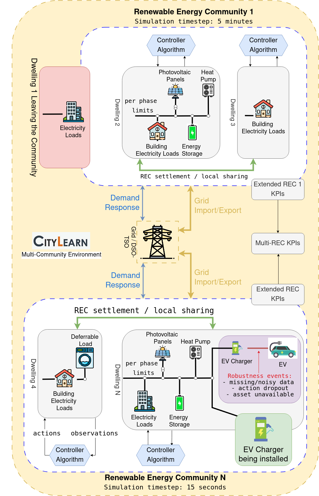

# SoftCPS REC Simulator

SoftCPS REC Simulator is the Soft-CPS Research Group's distribution of [CityLearn](https://github.com/citylearn-project/CityLearn), an open-source Gymnasium environment for building energy coordination, demand response and reinforcement learning. It runs the same simulator code as CityLearn, is installed as `softcpsrecsimulator`, and adds SoftCPS datasets.

Use it to configure renewable energy communities with buildings and thermal systems, PV, batteries, EVs and flexible loads, electrical limits, local energy sharing, changing members and assets, and data or equipment failures, then run controllers and compare energy, cost and service outcomes.

[Documentation](docs/) · [Features](docs/features.md) · [KPIs and scorecard](docs/scorecard.md) · [Portuguese documentation](docs/pt/) · [CityLearn UI](https://citylearnui.netlify.app/)

## Install

```console
python -m pip install softcpsrecsimulator
```

The Python import name is `citylearn`, as in CityLearn. Use Python 3.9 or newer in a virtual environment. See the [installation guide](docs/source/installation.rst) for optional dependencies, including Parquet support.

## Configure your community

<p align="center">
  <a href="https://raw.githubusercontent.com/Soft-CPS-Research-Group/Simulator/master/assets/images/citylearn-v3-overview.png">
    
  </a>
</p>

The figure illustrates the community configurations and services available. Individual scenarios can use different time resolutions; synchronized multi-community runs use a common timestep.

## Run your first simulation

This example downloads a public dataset on first use, runs a short episode with the built-in business-as-usual controller and prints community KPIs. It works outside a repository checkout.

```python
from citylearn.agents.baseline import BusinessAsUsualAgent
from citylearn.citylearn import CityLearnEnv

env = CityLearnEnv(
    "citylearn_challenge_2022_phase_all_plus_evs",
    episode_time_steps=24,
    interface="flat",
    render_mode="none",
)
agent = BusinessAsUsualAgent(env)
observations, info = env.reset(seed=0)
terminated = truncated = False

while not (terminated or truncated):
    actions = agent.predict(observations)
    observations, rewards, terminated, truncated, info = env.step(actions)

kpis = env.evaluate_v2()
selected = [
    "district_cost_total_control_eur",
    "district_energy_grid_total_import_control_kwh",
    "district_ev_performance_departure_min_acceptable_feasible_ratio",
    "district_electrical_service_phase_violations_energy_total_kwh",
]
print(kpis.loc[
    (kpis["level"] == "district") & kpis["cost_function"].isin(selected),
    ["cost_function", "value"],
].to_string(index=False))
env.close()
```

A runnable copy is in [examples/first_simulation.py](examples/first_simulation.py). Datasets download from this repository at the release tag `softcpsrecsimulator-v<version>`.

## Datasets

All CityLearn datasets are included, among them the [Portugal REC datasets](docs/portugal_rec_datasets.md) `pt_rec_4`, `pt_rec_15`, `pt_rec_30` and `pt_rec_100`, which replace the earlier SoftCPS `rec_pt_2023_*_v2` names (see the [migration guide](docs/migration.md#upgrade-from-softcps-211-to-220)). SoftCPS also ships the 19 `ALADI *` datasets and `EC_Ermesinde`.

See the [dataset reference](docs/dataset_reference.md) for the file and column contract.

## Learn more

- [Features and configuration](docs/features.md): choose assets, services, interfaces and scenario conditions.
- [Running simulations](docs/running_simulations.md): Python, CLI, datasets, exports and advanced examples.
- [Baselines](docs/baselines.md), [KPIs](docs/kpis_reference.md) and [scorecard](docs/scorecard.md): understand the reference controllers, metrics and comparisons.
- [Validation and performance](docs/validation.md): audits and measured results.
- [Migration guide](docs/migration.md): changes that affect results between versions.
- [Developer guide](docs/developer_guide.md) and [publishing guide](docs/publishing.md): tests, audits and the `softcpsrecsimulator` release process.

## Cite and contribute

Cite CityLearn as described in the [CityLearn publications](docs/source/publications.rst). Simulator changes are developed with [CityLearn](https://github.com/citylearn-project/CityLearn); SoftCPS-specific datasets and releases are maintained in [Soft-CPS-Research-Group/Simulator](https://github.com/Soft-CPS-Research-Group/Simulator). Distributed under the [MIT license](LICENSE).
