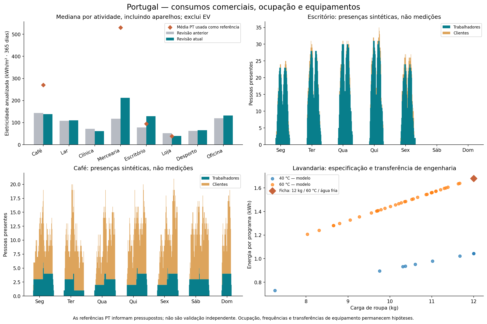

# Portugal v3.3 — passagem de trabalho para a tese

Data: 1 de novembro de 2026. Âmbito: questões 53-F1 e 53-F3 do plano do capítulo 5.
Nenhum ficheiro da tese foi alterado. Esta entrega modifica condições experimentais;
não apresenta resultados anuais de controladores nem resultados de aprendizagem.

## Revisão corrente de realismo e mobilidade — 5 de novembro de 2026

`portugal-realism-4` e `portugal-ev-mobility-1` substituem os calendários de
atividade, mobilidade, aparelhos, consumos e perturbações de **2023 e 2024**.
As afirmações históricas mais abaixo sobre preservação dos inputs de 2023
referem-se à intervenção original v3.3. Na revisão corrente, ambos os braços
de cada comparação recebem os mesmos inputs revistos. Mantêm-se equipamentos,
limites, histórias de topologia, energia anual de condução e convenção OMIE.

Reprodução: `python scripts/revise_portugal_realism.py --apply`, com origem
imutável `c54b13b62823fb1256397ea98cb37a830a24124d` disponível no Git, sem extrair
cópias. Ver [Fontes e método](Fontes_e_metodo.md) para os mecanismos, parâmetros,
referências científicas e limites de validação. A variabilidade da procura
agregada foi ajustada em sete casas portuguesas SHEERM e avaliada em seis casas
separadas. A revisão 3 acrescenta BDG2, REFIT e FIKElectricity, com separação
prévia dos edifícios/aparelhos usados no ajuste e na avaliação. Mobilidade, SOC,
transferências comerciais e usos individuais continuam a incluir priors;
não se afirma realismo populacional validado nem preparação concluída para
publicar um paper.

As distribuições dos residentes em 2024 abaixo são por sessão; a frequência é
por veículo. As bases têm 2, 6, 9 e 37 EV residentes. Os perfis frequente,
periódico, bateria baixa e empresa são escolhas de desenho, não percentagens
medidas da população. Visitantes permanecem uma população distinta.

| Base | SOC médio à chegada | Objetivo médio | Pedido médio (p.p.) | Cargas/EV/semana | Pedidos a 100% | Chegada ≤5% e pedido a 100% |
|---|---:|---:|---:|---:|---:|---:|
| 4 membros | 56,00% | 84,84% | 28,84 | 2,11 | 10,41% | 1,36% |
| 15 membros | 46,62% | 86,92% | 40,30 | 1,27 | 13,32% | 2,01% |
| 30 membros | 45,52% | 87,89% | 42,36 | 1,15 | 13,63% | 1,47% |
| 100 membros | 45,10% | 87,20% | 42,09 | 1,29 | 12,68% | 2,09% |

| Pedido por sessão (p.p.) | 4 membros | 15 membros | 30 membros | 100 membros |
|---|---:|---:|---:|---:|
| <10 | 19,46% | 19,85% | 14,73% | 13,76% |
| 10–<30 | 44,34% | 23,12% | 17,13% | 23,76% |
| 30–<50 | 17,19% | 14,07% | 24,49% | 17,66% |
| 50–<70 | 14,48% | 25,38% | 32,41% | 30,62% |
| ≥70 | 4,52% | 17,59% | 11,23% | 14,21% |

Os pedidos a 100% são sujeitos a tempo de ligação, perdas, taper e margem de
potência partilhada com os aparelhos. O SOC tem balanço contínuo no gerador,
incluindo carga externa finita. O simulador continua a receber SOC prescrito à
chegada. Esta trajetória offline prova a viabilidade dos pedidos no cenário
normal; não é uma previsão perfeita validada dos condutores nem um resultado MARL.

As evidências correntes estão em `ev_mobility_revision.json`, `realism_revision.json`,
`catalogs/household_activity.parquet`, `catalogs/mobility_episodes.parquet`,
`catalogs/grid_event_programme.parquet` e `catalogs/ev_annual_energy.parquet` de
cada base. Os hashes permitem distinguir esta revisão dos resultados anteriores.
Os campos antigos `soc_preference`, `reserve_soc`, narrativas e valores de
planeamento conservam a proveniência do dimensionamento; `charging_profile`
e os catálogos de sessões/atividade são a descrição operacional corrente.

A auditoria corrente de coerência/diversidade fica em
`results/portugal_rec_native/realism_validation.json`; a de comparabilidade e
fronteiras em `heldout_2024/validation.json`. Não houve novo treino MARL nem
benchmark anual de controladores. As figuras e avaliações anteriores mantêm o
seu âmbito histórico; a figura desta revisão é `figures/realism_validation.png`.

Duas gerações completas da revisão 4 reproduziram **1 969 Parquet byte a byte**.
Validação local concluída: **161 testes distintos**, **72 janelas de execução
nas transições/fronteiras**, **27 sondas de falhas** e **18 janelas de balanço
energético**, todos aprovados. Os seis pares de comparação, os nove schemas
de preparação e os 2 090 hashes dos ficheiros das famílias foram verificados.
A maior discrepância energética nas janelas contabilísticas foi **2,37 × 10⁻⁷ kWh**;
a maior diferença de KPI face ao cálculo independente foi **9,10 × 10⁻¹³**.
As 80 realizações de componentes, 14 regenerações físicas/aparelhos/EV,
72 sensibilidades dessa cadeia e 80 regenerações de eventos também passaram.

Comandos, versões e hashes ficam em `realism_validation.json` e
`commercial_appliance_validation.json`, campo `software_validation`.
Todas as evidências de execução correspondem ao fingerprint
`e9643a8e581f93989a7a5dca3f1009c4beadce4bdf115d37a24b139ae2846445`.
São verificações locais e amostradas; não houve CI remoto, benchmark anual,
commits ou publicação. O caso comercial extremo rejeitado na sensibilidade
é descrito separadamente abaixo, sem o contar como uma geração realista aprovada.

### Consumos e ocupação: resultados da revisão 4

Esta revisão acrescenta referências portuguesas para escritórios e pequeno
comércio, heterogeneidade anual persistente entre estabelecimentos, presença
discreta de trabalhadores/clientes/residentes e programas de lavandaria
informados por uma ficha de fabricante. Os dados de calibração, o protocolo
anterior e os limites de transferência estão em [Fontes e método](Fontes_e_metodo.md#referências-portuguesas-e-correções-da-revisão-4).
As comparações com BDG2/REFIT/FIKElectricity são agora diagnósticos repetidos,
não uma nova avaliação independente após os resultados da revisão 3.

A tabela compara a mediana entre estabelecimentos em 2024, normalizada a
365 dias, em kWh/m²/ano. Inclui os aparelhos uma única vez e exclui EV.
Os valores não são resultados de um controlador nem estimativas populacionais.

| Atividade | Revisão 3 | Revisão 4 | Intervalo entre locais | Referência PT usada |
|---|---:|---:|---:|---:|
| Escritórios | 78.1 | 129.0 | 79.2–132.8 | 94.4 |
| Lojas | 52.2 | 39.6 | 36.3–59.5 | 39.0 |
| Clínicas | 72.1 | 61.9 | 56.5–88.5 | — |
| Cafés/restauração | 143.8 | 138.2 | 125.4–186.9 | 271.0 |
| Oficinas | 120.2 | 131.7 | 116.2–167.2 | — |
| Centros desportivos | 62.7 | 65.4 | 64.5–66.4 | — |
| Lar | 108.0 | 110.7 | 110.7–110.7 | — |
| Mercearia refrigerada | 117.9 | 212.1 | 212.1–212.1 | 531.0 |

Os cinco escritórios desta realização não são forçados a reproduzir exatamente
a média portuguesa de referência. O centro do gerador e a mediana de cinco
locais são quantidades diferentes; reportam-se todas as sementes e não se
escolhe uma realização por proximidade à referência. A dispersão dos restantes
setores sem dados portugueses comparáveis continua um pressuposto explícito.

As 26 instalações têm contagens inteiras e composição explícita de ocupação;
não há clientes fora da abertura. Os trabalhadores de escritórios/oficinas têm
jornadas de 7,5–9 h, incluindo pausas, distintas do intervalo de serviço.
O lar preserva residentes durante a noite; visitas têm uma janela própria
das 10 às 20 h, assumida no cenário. O número de pessoas não varia por
alterar o ruído elétrico. Densidades, assiduidade e permanência não estão
calibradas com medições comerciais portuguesas.

Nas três lavandarias, as medianas de energia ficam em 1,40–1,46 kWh/programa,
com duração mediana de 1 h e 428, 443 e 484 programas em 2024. A roupa modelada
é 4,48–4,85 t/ano por máquina; não se afirma que cubra toda a roupa produzida
pelo edifício. A máquina de loiça profissional tem 2001 lotes agregados em 2024,
mediana de 0,465 kWh e 15 minutos, além do apoio térmico não deslocável.
A frequência e os prazos destes equipamentos continuam hipóteses de cenário.

O balanço anual foi corrigido: o orçamento comercial inclui todos os pedidos
de aparelhos uma única vez, em vez de os adicionar novamente ao consumo de
referência. A maior diferença nos 52 balanços edifício/ano é inferior a
0,000024 kWh. O aquecimento inicial da máquina de loiça ocupa o primeiro
intervalo; todos os inícios admissíveis respeitam a potência conjunta.

As **20 sementes comerciais** passaram nos oito setores (160 realizações),
com 100 bibliotecas de aparelhos. A sensibilidade avaliou 72 configurações
emparelhadas e os oito setores: **575 casos aceites e um rejeitado**. A transferência
integral da referência refrigerada, na semente 20263123, leva a 63,5% dos
intervalos no limite do contrato e seis formas diárias repetidas. Não houve
orçamento anual superior à capacidade energética nos casos avaliados. Essa
configuração extrema não é entregue como um perfil realista; os datasets usam
a transferência parcial e não exibem cópias diárias exatas.

Nos componentes comerciais de 20 sementes, os P10/P50/P90 da intensidade
anualizada são 74,2/95,4/139,5 nos escritórios, 35,7/45,7/58,6 nas lojas,
128,1/153,2/172,3 na restauração e 223,0/239,8/255,8 nos refrigerados.
São intervalos Monte Carlo do componente de usos finais, com um local por
setor, não intervalos de confiança populacionais nem a distribuição dos cinco
escritórios da realização entregue. A cadeia completa com aparelhos/EV é
verificada separadamente em `ensemble_validation.json`.

### Comerciais e aparelhos: resultados históricos da revisão 3

A auditoria abrange os **26 estabelecimentos comerciais**, oito tipos de uso,
e todos os aparelhos das quatro bases. Não há fábricas industriais: oficinas
não são apresentadas como fábricas. Os cinco escritórios somam 22 postos,
com mediana de quatro e máximo de 12; os restantes estabelecimentos somam 12.
Todos respeitam o número de lugares de estacionamento e todas as visitas
ficam dentro da abertura. Potências nominais somadas dos postos podem exceder
o contrato sob gestão de potência; isso não equivale a violação simultânea.

A reprodução integral gerou **1 969 Parquet idênticos byte a byte**. Os oito
setores passaram em 20 sementes (160 realizações), mais 30 configurações de
sensibilidade (240 realizações) e 100 bibliotecas de aparelhos sorteadas.
Os consumos revistos não têm formas diárias exatamente repetidas, incluindo
encerramentos. Mantêm-se os horários públicos regulares, feriados, férias e
atividade de preparação/limpeza, com variação correlacionada de procura.
A auditoria corrigiu a conversão das férias em ano bissexto e atualizou os
membros suplementares que reutilizam explicitamente um perfil dador.

Comparação horária com os edifícios BDG2 reservados: mediana por edifício,
2024 sintético versus medições 2016–2017. O indicador abaixo é o P95 da
variação absoluta entre horas dividido pela potência média. Valores mais
próximos da referência não são uma percentagem de realismo.

| Setor | Antes | Revisto | Referência reservada |
|---|---:|---:|---:|
| Escritórios | 1,85 | 0,42 | 0,33 |
| Lojas | 1,70 | 0,74 | 0,34 |
| Clínicas | 1,85 | 0,52 | 0,18 |
| Cafés | 1,38 | 0,55 | 0,43 |
| Oficinas | 2,12 | 0,35 | 0,35 |
| Desporto | 1,26 | 0,57 | 0,23 |
| Lar | 0,19 | 0,20 | 0,28 |
| Supermercado | 1,10 | 0,47 | 0,34 |

A comparação também mostra limites importantes. As intensidades anuais ainda
não coincidem com a amostra externa; países, dimensão e serviços energéticos
são diferentes e há setores com apenas um ou dois edifícios reservados.
O supermercado não teve edifício de desenvolvimento. Não houve reajuste depois
de consultar os reservados. A transferência conservadora não garante uma
melhoria em todos os indicadores: a intensidade das oficinas, por exemplo,
afastou-se da mediana reservada, embora a estrutura horária se tenha aproximado.

| Setor | Revisto (kWh/m²/ano) | Referência reservada (kWh/m²/ano) |
|---|---:|---:|
| Escritórios | 78,05 | 180,21 |
| Lojas | 52,19 | 252,81 |
| Clínicas | 72,11 | 166,19 |
| Cafés | 143,79 | 241,42 |
| Oficinas | 120,18 | 65,76 |
| Desporto | 62,72 | 124,94 |
| Lar | 108,05 | 195,28 |
| Supermercado | 117,94 | 28,66 |

Nos aparelhos domésticos, a energia e a duração passam a ser amostradas
conjuntamente a partir das casas REFIT de desenvolvimento. A tabela mostra
medianas das medianas por aparelho; as duas casas reservadas têm comportamentos
muito distintos e não constituem uma estimativa nacional.

| Aparelho / métrica | Antes | Revisto | Referência reservada |
|---|---:|---:|---:|
| Roupa — kWh/programa | 0,62 | 0,48 | 0,51 |
| Roupa — h/programa | 3,38 | 1,25 | 1,35 |
| Loiça — kWh/programa | 0,90 | 1,23 | 1,28 |
| Loiça — h/programa | 3,75 | 1,75 | 1,76 |

A frequência mantém-se como pressuposto do inventário. Nas duas casas
reservadas, a loiça varia entre **0,86 e 6,56 candidatos/semana**; logo, a média
isolada esconderia diferenças grandes. A extração também importa: na casa 5,
a mediana de duração da loiça varia entre 1,91 e 2,51 h conforme limiar e
intervalo entre etapas. Esta incerteza é reportada, não eliminada escolhendo
o detetor que mais se aproxima do gerador.

No café com máquina profissional, 2024 contém **991,93 kWh em lotes deslocáveis**
e **1 143,12 kWh de aquecimento/manutenção não deslocáveis**. O segundo valor
foi reclassificado da base, sem contagem dupla. A máquina medida FIKElectricity
tem mediana observada de 9,06 kWh/dia, mas não é o mesmo equipamento/contexto.
Os parâmetros profissionais e a lavandaria continuam a ser hipóteses; não
foram validados como população de máquinas portuguesas.

Fontes, licenças, cobertura, separação prévia e limitações em
[Fontes e método](Fontes_e_metodo.md). Resultados completos em
`results/portugal_rec_native/commercial_appliance_validation.json`.

### Comparação externa residencial corrente

Foram usados os ficheiros `raw` de [13 casas SHEERM portuguesas](https://doi.org/10.5281/zenodo.13972210),
com sete casas para desenvolvimento e seis reservadas. A tabela mostra medianas
por casa: 80 casas residenciais Premium em 2024 e as seis casas medidas. As
restantes bases têm comparações próprias em `empirical_validation.json`.

| Métrica | Antes | Revisto | Medido, seis casas |
|---|---:|---:|---:|
| Energia diária média (kWh) | 7,84 | 7,78 | 5,99 |
| Variabilidade diária dentro do mês (CV) | 0,270 | 0,408 | 0,360 |
| P95 da variação de potência / média | 0,809 | 1,552 | 1,245 |
| Desvio da forma diária | 0,253 | 0,539 | 0,522 |
| P99 da potência / média | 4,460 | 5,633 | 6,722 |
| Autocorrelação a um dia | 0,475 | 0,232 | 0,298 |
| Autocorrelação a uma semana | 0,442 | 0,195 | 0,296 |
| Concentração do horário do pico diário | 14,42% | 5,77% | 6,54% |

A distância diagnóstica média das cinco métricas usadas no desenvolvimento
diminuiu de 0,464 para 0,161 na avaliação Premium. **Isto não significa uma
percentagem equivalente de realismo.** A energia média continua cerca de 30%
mais alta e o pico relativo P99 cerca de 16% mais baixo. A pequena amostra,
as estações observadas e os equipamentos diferentes limitam a interpretação.
O consumo sintético inclui os aparelhos no primeiro início admissível e exclui
EV; não é uma curva medida nem um resultado de controlo.

A exclusão de três dias com leituras anómalas na referência real, numa
sensibilidade de qualidade separada, não altera materialmente estas medianas.
Não se reajustou o gerador depois dessa inspeção; ver o método e os resultados
completos no campo `measured_quality_sensitivity` da evidência empírica.

O confronto EV usa [35 377 sessões medidas na Noruega](https://doi.org/10.5281/zenodo.13896176),
sem SOC/capacidades inferidos. Após filtros comuns, a referência reservada tem
18 259 sessões de 140 utilizadores. Em sessões domésticas Premium, a mediana
de energia AC pedida é **25,84 kWh**, versus **9,04 kWh** medidos; a mediana de
frequência doméstica por utilizador e intervalo observado é **0,89/semana**,
versus **2,44/semana**. Estes valores usam fronteiras/filtros diferentes da
tabela de todos os carregamentos dos residentes acima. A discrepância é
mantida explícita: a composição da frota real é desconhecida e os pedidos
grandes são preferências deliberadas deste cenário, não um ajuste populacional.
A mediana do tempo ligado é 16,75 h, contra 11,11 h; a correlação de Spearman
entre energia e duração é 0,05, contra 0,31. Portanto, a distribuição conjunta
também não está validada, mesmo existindo diversidade e viabilidade física.

As férias já não repetem exatamente os mesmos dias nos dois anos nas 123
posições residenciais das quatro bases (Micro/Core partilham identidades).
Não foram encontradas séries de consumo de membros
duplicadas nem coincidências de início entre causas locais independentes
na realização corrente. A sincronização das causas comuns e dos casos de
stress continua explícita. A forte correlação PV é esperada porque todos os
locais partilham meteorologia de Lisboa; não representa nuvens locais medidas.

Ver `figures/empirical_validation.png`, `ensemble_validation.json` e
[Fontes e método](Fontes_e_metodo.md) para a análise das sementes, sensibilidade,
fontes, limites e tarefas científicas ainda necessárias.

### Sementes e sensibilidade

As 20 sementes passaram nas quatro bases: 80 realizações de componentes e
80 regenerações dos programas de sensores/DR. As experiências de componentes
usam uma casa por rotina (quatro na Micro e seis nas restantes bases), mantendo
os outros usos e pedidos de aparelhos fixos. A tabela mostra a mediana entre
essas casas da variabilidade diária dentro do mês, não a dispersão de toda a
população nem um intervalo de confiança populacional.

| Base | Mediana das 20 sementes | Mínimo–máximo |
|---|---:|---:|
| 4 membros | 0,371 | 0,356–0,405 |
| 15 membros | 0,375 | 0,361–0,411 |
| 30 membros | 0,375 | 0,361–0,411 |
| 100 membros | 0,377 | 0,353–0,400 |

Core-15 e Core-30 dão aqui os mesmos valores porque as seis identidades e
fluxos escolhidos coincidem; isso é o controlo de comparabilidade, não uma
segunda amostra independente. As 14 regenerações de toda a cadeia física/
aparelhos/EV também passaram. Os pedidos médios dos residentes em 2024 ficaram
em 28,01–29,75 p.p. na Micro (cinco sementes), 37,58–41,51 na Core-15 (cinco),
43,23–43,76 na Core-30 (duas) e 42,36–42,47 na Premium (duas). Duas realizações
grandes não estabelecem cobertura das caudas; a realização principal tem outra
semente e as distribuições detalhadas acima.

A análise local de 12 parâmetros usa ±25% e três sementes emparelhadas
(72 realizações). Na mediana dos pares, reduzir/aumentar o desvio diário muda
a variabilidade entre dias em −14,5%/+16,4%. Alterar o peso dos episódios muda
as variações entre quartos de hora em −16,1%/+16,7%. Alterar a persistência dos
episódios muda essa métrica em +47,6%/−37,4%: é uma hipótese influente, que deve
entrar nas ablações e na incerteza de resultados futuros. Os efeitos completos,
incluindo energia/janelas dos aparelhos, ficam no relatório JSON.
Na Micro, a perturbação da dispersão da energia dos ciclos altera a energia
pedida em menos de 0,4% na mediana dos pares; a dispersão dentro de cada aparelho
muda −3,5%/+2,8%. A variação da dispersão das janelas muda o P90 da folga em
−3,6%/+8,6%. Estes efeitos são condicionados aos programas e inventário fixos.
Nenhuma destas experiências estima a sensibilidade de uma política MARL ou
substitui uma análise global com interações entre parâmetros.

## Edição e proveniência

Edição: **portugal-native-2023-2024-v3.3**. Revisão da campanha:
**portugal-heldout-2024-1**. Mantém-se **portugal-boundaries-1** para as fronteiras EV.
O motor de partida desta intervenção é 1.9.11, commit
`8157f605e26fb75651037451fb453b1a48056787`. O trabalho foi isolado das alterações
locais de outra auditoria do simulador; esta extensão não substitui o motor.

Esse mesmo commit preserva integralmente a edição v3.2 anterior. O manifesto
anterior está também em `results/portugal_rec_native/heldout_2024/previous_manifest.json`.
Cada configuração principal conserva o seu schema de origem em
`evaluation/campaign_2024/source_schemas/`. As séries físicas originais não são
sobrescritas: os novos inputs derivados ficam em `evaluation/campaign_2024/inputs/`.
`source_input_checksums.json` identifica os inputs anteriores preservados. A
reconstrução recusa continuar se esses inputs forem alterados sem revisão.

Os PDF, figuras, atlas e tabelas descritivas anteriores continuam a identificar
v3.2. Não devem ser usados como prova dos eventos ou populações de v3.3. A presente
descrição, os catálogos suplementares e a evidência de auditoria são a passagem
de trabalho atual. Os resultados antigos não são reatribuídos à nova edição.

## Bases, configurações e identidades

Mantêm-se as quatro bases físicas originais, com inventários estáticos de 4, 15,
30 e 100 membros, e as nove configurações principais. Core-4, Core-15, Core-30
Normal/Safety/Robustness e Premium Normal conservam os seus inputs físicos.
Core-30 Topology/Combined e Premium All-in recebem a campanha abaixo.

Todos os membros originalmente disponíveis nos dois catálogos dinâmicos já
tinham entrado em 2023; as saídas são permanentes. Por isso, uma nova entrada
efetiva exige uma identidade adicional: **Member_031** em Core-30 e **Member_101**
em Premium. As duas variantes Core-30 partilham a mesma Member_031. Não se
readmite Member_001, Member_008, Member_011 ou qualquer outro membro que saiu.

As novas identidades representam instalações de serviços fictícias sem PV,
bateria, EV ou pedidos de aparelhos controláveis. Reutilizam explicitamente o
arquétipo físico e o contrato elétrico de Member_027 (Core) e Member_088 (Premium),
respetivamente. Isto é reutilização determinística de um perfil para um novo
local sintético, não uma nova observação independente. Antes da admissão, carga,
ocupação, PV e cortes são zero. Depois, há procura efetiva e liquidação comunitária.
Preços, meteorologia e carbono são os mesmos da base. Não se inventam veículos
nem obrigações de serviço para preencher o novo membro.

O inventário base não é aumentado nas configurações estáticas. O conjunto de
identidades possíveis nas configurações dinâmicas passa a 31 e 101, mas os máximos
ativos durante 2024 são 28 e 89. O catálogo suplementar em cada base é
`evaluation/campaign_2024/catalogue.json`, incluindo identidades, origem dos perfis,
contratos, baterias instaladas e inventários cronológicos.

## Calendário reservado de 2024

Todas as horas desta tabela são de Lisboa, com a mudança de hora refletida nos
timestamps UTC dos ficheiros. Os eventos são executados nas datas reais; não
foram deslocados para o início de episódios de teste.

| Data e hora local | Core-30 Topology e Combined | Premium All-in |
|---|---|---|
| 12 fevereiro, 12:00 | Primeira entrada de Member_031 | Primeira entrada de Member_101 |
| 13 maio, 12:00 | Instalação de BESS-M010-01 em Member_010 | Instalação de BESS-M029-01 em Member_029 |
| 20 maio, 12:00 | Retirada de BESS-M014-01 | Retirada de BESS-M014-01 |
| 22 maio, 12:00 | Instalação da substituta BESS-M014-02 | Instalação da substituta BESS-M014-02 |
| 12 agosto, 12:00 | Saída permanente de Member_020 e do carregador associado | Saída permanente de Member_020 e do carregador associado |
| 11 novembro, 12:00 | Reforma permanente de PV-M023-01 | Reforma permanente de PV-M099-01 |

São seis eventos por história, 18 registos nas três configurações principais.
As duas configurações Core partilham a campanha, pelo que não são 18 intervenções
independentes. As referências que mantêm a topologia usam os mesmos seis eventos.
Os 13 eventos Core e os 46 eventos físicos Premium de 2023 permanecem inalterados;
o registo interno Premium que oculta um template no passo zero continua separado.

As baterias novas/substitutas têm 5,12 kWh, 2,56 kW, eficiência 0,94, profundidade
de descarga 0,9 e SOC inicial de 10%. A substituição tem um intervalo real de
48 horas sem bateria, e a nova unidade tem identidade própria. A componente
exógena de standby acompanha a presença da bateria (8 W). A reforma do PV elimina
a produção efetiva e o recurso na interface. Não se reativa equipamento reformado.
No motor atual, a tabela de baterias usa o identificador do slot
`Member_014/electrical_storage`; a identidade física `BESS-M014-02` fica no evento
e no catálogo. O slot desaparece durante a substituição e regressa com uma nova
instância e o SOC de comissionamento, sem se afirmar que o identificador da linha
da interface distingue os dois produtos físicos.

Para analisar continuidade e recuperação, usar janelas com 14 dias antes e 14
dias após cada grupo: 29 janeiro–26 fevereiro; 29 abril–5 junho para o grupo de
maio; 29 julho–26 agosto; 28 outubro–25 novembro, sempre ancoradas às 12:00 locais.
As janelas de maio incluem instalação, retirada, intervalo sem bateria,
substituição e recuperação. Estes recortes não substituem a avaliação anual.

## Populações e recursos

As contagens de aparelhos referem-se a recursos controláveis, não a todos os
aparelhos presentes no inventário descritivo. As identidades exatas constam da
cronologia do catálogo suplementar e das verificações de execução.

| História / instante | Membros | Carregadores | Aparelhos controláveis | PV | Baterias |
|---|---:|---:|---:|---:|---:|
| Core-30 dinâmica, início de 2024 | 27 | 13 | 18 | 9 | 2 |
| Após entrada de fevereiro | 28 | 13 | 18 | 9 | 2 |
| Após instalação de maio | 28 | 13 | 18 | 9 | 3 |
| Durante intervalo de substituição | 28 | 13 | 18 | 9 | 2 |
| Após substituição | 28 | 13 | 18 | 9 | 3 |
| Após saída de agosto | 27 | 12 | 18 | 9 | 3 |
| Após reforma de novembro / fim de 2024 | 27 | 12 | 18 | 8 | 3 |
| Premium All-in, início de 2024 | 88 | 63 | 57 | 33 | 19 |
| Após entrada de fevereiro | 89 | 63 | 57 | 33 | 19 |
| Após instalação de maio | 89 | 63 | 57 | 33 | 20 |
| Durante intervalo de substituição | 89 | 63 | 57 | 33 | 19 |
| Após substituição | 89 | 63 | 57 | 33 | 20 |
| Após saída de agosto | 88 | 62 | 57 | 33 | 20 |
| Após reforma de novembro / fim de 2024 | 88 | 62 | 57 | 32 | 20 |

## Referências emparelhadas

As referências são schemas executáveis em `evaluation/references/`, relativos à
respetiva base. Não são novos controladores BAU/RBC. Um candidato e o seu
controlador de referência continuam a executar **o mesmo schema** e a mesma
história; os pares abaixo servem para estudar fatores experimentais.

| Cenário | Referência (nome do ficheiro, sem `.json`) | Única intervenção removida |
|---|---|---|
| Core-30 Combined | `core_30_combined_no_disturbances` | Campanha conjunta de health e cortes; mantém reconfiguração e limites apertados |
| Core-30 Combined | `core_30_combined_nominal_limits` | Aperto adicional dos contratos elétricos; mantém reconfiguração, health e cortes |
| Premium All-in | `premium_100_allin_no_disturbances` | Campanha conjunta de health, ruído e cortes; mantém reconfiguração e DR |
| Premium All-in | `premium_100_allin_no_dr` | Ativação de DR; conserva os pedidos como registo do contrafactual, além de reconfiguração e perturbações |
| Core-30 Topology | `core_30_topology_frozen_2024` | Apenas os eventos de reconfiguração de 2024; mantém toda a história de 2023 |
| Premium All-in | `premium_100_allin_frozen_2024` | Apenas os eventos de reconfiguração de 2024; mantém a história de 2023, as perturbações e DR |

Não se criam novas bases nem se duplicam variantes para cada falha. As duas
referências congeladas são necessárias porque as histórias Core/Premium são
distintas. Topology já fornece o cenário Core sem perturbações nem aperto de
limites; não é uma referência adequada para remover apenas perturbações de
Combined, porque também removeria o fator elétrico.

Retirar cortes significa pôr `power_outage=0` e repor o PV que a construção
original tinha suprimido exclusivamente por falta de backup durante esses cortes,
respeitando a presença do membro e do PV. Esta reposição é consequência do fator
retirado; não é alteração meteorológica. Todas as outras colunas são iguais.
A referência elétrica repõe os contratos de Member_001, Member_006 e Member_025;
Member_001 já saiu antes de 2024, pelo que o contraste elétrico reservado atua
efetivamente sobre os dois membros ainda presentes. Não se eliminam limites de
segurança: repõem-se os limites nominais publicados.

As referências sem perturbações estimam um contraste de **campanha conjunta**.
Não permitem atribuir o efeito a uma única falha. Um diagnóstico individual deve
partir do mesmo cenário, remover apenas os IDs e canais dessa falha e verificar
novamente o pareamento. Não foram criados ou executados esses contrastes
individuais, pois não existe aqui uma pergunta de atribuição selecionada.

Nos contrastes de reconfiguração, as condições e a comunidade ativa coincidem
até ao primeiro evento de 2024. Depois, participação e recursos são precisamente
o fator estudado: os totais absolutos deixam de representar o mesmo universo.
Usar a exposição completa de cada história, os membros comuns e as coortes de
serviço identificadas, declarando o contrafactual sem campanha. Não impor
artificialmente a mesma população nem interpretar menor procura como melhor controlo.
Premium mantém as mesmas seeds/configurações estocásticas; uma topologia diferente
pode alterar a ordem de consumo de números aleatórios do motor. Isto não prova
ruído realizado idêntico por entidade depois da divergência. O contraste Core
Topology não tem esse fator de ruído.

## Serviços, fronteiras e denominadores

A saída de Member_020 foi colocada num intervalo sem visitas em curso em ambas
as bases, verificado sobre todas as visitas dos seus veículos, incluindo visitas
noutros membros. Não há aparelhos controláveis associados a esse membro. Os
pedidos anteriores à saída mantêm identidades, duração, SOC e objetivos. Depois
da saída não existe carregamento privado dentro desta REC.

| História | Visitas oferecidas na trajetória anterior | Visitas na nova trajetória | Excluídas pela saída de 2024 | Visitas em curso cortadas |
|---|---:|---:|---:|---:|
| Core-30 Topology | 8 587 | 8 481 | 106 | 0 |
| Core-30 Combined | 8 587 | 8 481 | 106 | 0 |
| Premium All-in | 40 072 | 39 982 | 90 | 0 |

Estas são contagens de visitas oferecidas nos dois anos pelas histórias
executáveis, não o total do catálogo estático nem resultados de cumprimento.
As visitas excluídas representam pedidos de energia de referência de cerca de
485,24 kWh em cada variante Core e 694,12 kWh em Premium. Esses valores são
pedidos de input, não energia consumida nem poupada. As variantes Core reutilizam
as mesmas visitas e não devem ser somadas como amostras independentes.

Os ficheiros `*_service_cohorts.parquet` em `results/portugal_rec_native/heldout_2024/`
retêm uma linha por visita do catálogo, com identidade, intervalos, pedido,
presença nas duas trajetórias e motivo de exclusão. As exclusões anteriores à
campanha ficam noutra categoria. Visitas terminais sem partida conhecida
continuam com `right_censored=true`, sem as converter em partidas ou sucessos.
Todos os horários e perfis de aparelhos controláveis permanecem iguais.

As quatro referências que mantêm a reconfiguração têm exatamente a mesma
população de serviços do seu cenário. As referências congeladas conservam a
população anterior; por isso, a comparação deve publicar os denominadores de
cada trajetória e a coorte comum. A energia dos membros presentes não deve ser
dividida silenciosamente pelo inventário completo de 30/100, nem pelo conjunto
de 31/101 identidades possíveis.

## Separação temporal e estado

Mantêm-se 2023 para preparação/seleção e 2024 para avaliação reservada. As quatro
quinzenas de validação de 2023 e os restantes intervalos de treino não mudam.
Todos os eventos e inputs executáveis de 2023 são preservados. Os nomes legados
`development`/`confirmation` dos programas de perturbação não autorizam o uso dos
seus registos de 2024 para selecionar políticas, normalizações ou hiperparâmetros.
O calendário reservado pertence ao avaliador, não à informação futura do agente.

Usar para preparação os nove schemas em **`evaluation/preparation_2023/`**, listados
em `preparation_schemas` no manifesto. São vistas temporais das mesmas nove
configurações, não novas variantes experimentais. Limitam a execução ao passo
35 039, conservam o conjunto original de membros e removem os programas de
perturbação/DR de 2024 dos ficheiros selecionados. As séries físicas continuam
partilhadas, e o carregamento respeita a janela de execução; normalizadores e
seleção de dados externos também têm de respeitar esse limite e os blocos de validação.

Não usar diretamente o schema completo de avaliação durante a preparação: o
motor inclui nos metadados de ciclo de vida as identidades pré-carregadas ainda
inativas. As observações e ações ativas antes da primeira mudança coincidem com
o contrafactual, mas esses metadados de catálogo não são cegos. As vistas de 2023
excluem as identidades suplementares e os eventos reservados, incluindo nos
metadados expostos pelo motor. Este ponto foi verificado explicitamente.

O schema completo continua de 0 a 70 175: nenhuma reinicialização foi introduzida
em janeiro. Para transportar SOC e outras condições físicas entre anos é preciso
executar continuamente ou restaurar um checkpoint equivalente. Iniciar um episódio
diretamente em 2024 reconstrói a topologia anterior, mas não simula o estado físico
omitido. Os testes curtos de eventos são testes de integridade, não prova de
continuidade energética de um replay anual. Candidato e referência devem usar
a mesma convenção de arranque, checkpoint, período avaliado e seeds de execução.

## Verificações e ficheiros para integração editorial

- `scripts/prepare_portugal_heldout_2024.py`: transformação offline reproduzível,
  com deteção de alteração dos inputs de origem; não importa CityLearn.
- `scripts/audit/audit_portugal_heldout_2024.py`: comparação automática dos seis
  pares, identidades, disponibilidade, fronteiras, coortes e execução das janelas.
- `tests/test_portugal_heldout_2024.py`: regressões de todos os 18 eventos,
  referências, preservação da história e mudanças reais das interfaces.
- `results/portugal_rec_native/heldout_2024/campaign.json`: eventos com passos e
  timestamps, correspondência dos pares, inventários exatos e linhagem dos inputs.
- `results/portugal_rec_native/heldout_2024/validation.json`: resultados correntes,
  snapshots de execução, eventos efetivamente aplicados e limites da verificação.
- `evaluation/campaign_2024/catalogue.json`: suplemento de membros/equipamentos
  por base, sem alterar as tabelas de composição estática originais.

A auditoria de entrega usa 72 janelas: todos os novos eventos dos cenários e das
referências dinâmicas, mais a passagem de ano e o fim do período nas 15
configurações principais/de referência. Verifica IDs dos recursos, interfaces de
observação/ação, eventos aplicados, recompensas finitas, mercado a 80%, balanço
das trocas e exportação de KPIs. As janelas dos eventos têm 12 horas antes/depois;
não substituem as janelas experimentais de 14 dias nem a campanha anual.
O estado efetivo e as contagens executadas devem ser lidos em `validation.json`.

Os testes gerais de fronteiras e preços continuam necessários. A verificação dos
pares não aceita alterações adicionais de seeds, preços, previsões, meteorologia,
serviços, proteções não estudadas ou condições iniciais. O pedido DR excessivo
de 1500 kW por quatro horas mantém a categoria `impossible_stress`, separada dos
pedidos operacionais. O ficheiro de pedidos não é alterado na referência sem DR.
Os pares de perturbações, limites e DR retiram o fator declarado na trajetória
completa de dois anos; não representam automaticamente uma intervenção iniciada
apenas em janeiro de 2024. Os mesmos estados iniciais referem-se ao início comum
da execução. Num replay contínuo, diferenças posteriores de estado causadas pelo
fator são parte do contraste. Para atribuir apenas o efeito de ativação num
intervalo reservado, usar um checkpoint comum e declarar esse recorte adicional.

## Limitações e tarefas que permanecem fora do pedido

Não houve treino nem uma nova campanha anual de desempenho. A revisão corrente
EV fornece uma trajetória offline de referência com margens de potência
partilhadas e um envelope conservador para aparelhos. Isto não garante o
cumprimento sob perturbações ou sob qualquer política de controlo; os testes
individuais dos pedidos, por si só, também não provam viabilidade conjunta.
Os novos membros reutilizam arquétipos explicitamente, sem acrescentar evidência
estatística independente. Não foi construída uma referência de informação
perfeita nem um novo controlador convencional.

Permanecem para a tese a integração editorial de 53-F1/53-F3, atualização das
tabelas/figuras e reconciliação dos capítulos 6/7. Continuam em aberto o isolamento
do efeito do tamanho (53-F2), a escolha de experiências de transferência (53-F4)
e a seleção de diagnósticos individuais quando houver uma pergunta de atribuição
(53-F5). Nenhum desses resultados deve ser inferido da presente entrega.
