# Portugal REC datasets
*2023-2024 / DESCRIPTIVE DATA REPORT | PDF page 1*

Communities, assets and temporal patterns

A two-year collection of synthetic residential and service communities, informed by Portuguese energy, calendar and market sources. Four physical bases support nine scenario configurations at 15-minute resolution.

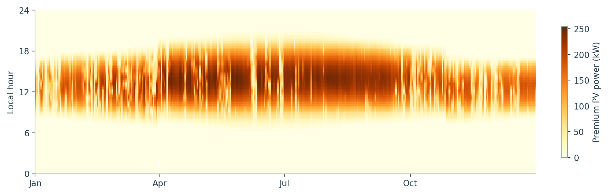
Figure 1. The Premium-100 solar calendar in 2024. Each column is one civil day and each row a local quarter-hour. Colour shows aggregate PV power. Seasonal daylight and day-to-day weather are visible in the inputs.

| 4 physical bases | 9 configurations | 731 days |
| --- | --- | --- |
| 4, 15, 30 and 100 members | Static and dynamic scenarios | 70,176 records per annual-pair series |

Dataset edition: portugal-native-2023-2024-v3.2
Report prepared: 29 October 2026
Scope: dataset composition and input distributions

This report describes the published data. All quantities are computed from inventories, schedules, schemas and input time series.

# Reading the collection
*PURPOSE AND READING GUIDE | PDF page 2*

The collection brings together households with different daily routines, workplaces and other services. Some members contribute generation or controllable equipment; others contribute consumption alone. The same calendar supports weather, electricity prices, carbon intensity and operating schedules.

The report starts with the catalogue and inventories, then follows the data from buildings and energy profiles to vehicles, appliance requests and scenario events. The final pages explain the shared signals, file organisation and source provenance.

| Part | Pages | What it describes |
| --- | --- | --- |
| Catalogue and construction | 3-5 | The nine configurations, base inventories and source-to-series construction. |
| Buildings and electricity | 6-16 | Households, routines, ownership, demand, PV, batteries and electrical connections. |
| Mobility and flexible cycles | 17-24 | EVs, chargers, visits, requested SOC, home-work links and appliance schedules. |
| Scenario histories | 25-29 | Membership and asset changes, health, measurement noise, outages and explicit DR requests. |
| Shared signals and documentation | 30-33 | Prices, carbon, weather, forecast inputs, files, units and sources. |

## Three counting conventions

**Inventory** means the complete physical base, as selected by its Normal configuration. **Active inventory** means assets belonging to members present at a particular time in a dynamic configuration. **Requests** means declared EV sessions or appliance cycles, rather than measured delivery.

Annual demand in this report is the non-shiftable electricity input. Flexible appliance requests are reported separately, as are EV connection and SOC requests. Stationary-battery dispatch and EV charging consumption depend on a subsequent controller and are not included in these exogenous energy totals.

The four bases are designed scenarios rather than four independent population samples. Member labels, construction rules and shared external signals recur across bases. The summed catalogue count is not a count of distinct real households.

# The nine configurations
*01 / CATALOGUE | PDF page 3*

Four physical bases are reused through a compact set of configurations. The 30-member family separates individual scenario dimensions, while the two 100-member configurations provide a static reference and an integrated event history.

| Configuration | Active members | Defining input characteristics |
| --- | --- | --- |
| Core-4 | 4 to 4 | Small residential base for inspection and setup. |
| Core-15 | 15 to 15 | Residential mix with several daily routines. |
| Core-30 Normal | 30 to 30 | Mixed residential and service reference. |
| Core-30 Topology | 26 to 27 | Membership and asset lifecycle changes. |
| Core-30 Safety | 30 to 30 | Selected electrical limits are more restrictive. |
| Core-30 Robustness | 30 to 30 | Health events, observation noise and outages. |
| Core-30 Combined | 26 to 27 | Topology, electrical stress, health and outages together. |
| Premium Normal | 100 to 100 | Larger mixed community with a richer asset inventory. |
| Premium All-in | 80 to 88 | Combined events, seasonal noise and explicit demand response. |

## What changes between variants

Core-30 Topology and Combined share the membership history. Safety and Combined modify selected electrical settings; the remaining configurations also have explicit electrical limits. Robustness and Combined contain health and outage events. Continuous measurement noise is selected in Core-30 Robustness; Combined uses the health events without that measurement-noise layer.

Premium All-in includes membership and asset changes, electrical stress, health, outages, measurement-noise campaigns and DR. Premium Normal has the same full-base equipment catalogue, with the event layers disabled. DR appears only in All-in.

The development and reserved confirmation event files are alternative schedules within this catalogue. They do not create additional physical bases or additional dataset names.

# Inventory at a glance
*02 / THE FOUR PHYSICAL BASES | PDF page 4*

The catalogue increases in scale while preserving mixed ownership. Premium contains more storage and charging infrastructure in absolute terms, together with large service installations.

| Full static inventory | Core-4 | Core-15 | Core-30 | Premium-100 |
| --- | --- | --- | --- | --- |
| Members | 4 | 15 | 30 | 100 |
| Residential / service sites | 4 / 0 | 15 / 0 | 24 / 6 | 80 / 20 |
| PV sites | 1 | 4 | 10 | 36 |
| PV capacity (kWp) | 3.78 | 16.80 | 89.46 | 312.48 |
| Stationary batteries | 1 | 1 | 3 | 20 |
| Battery energy (kWh) | 10.24 | 10.24 | 25.60 | 220.16 |
| Charging sites / connectors | 2 / 2 | 5 / 6 | 10 / 15 | 41 / 65 |
| Distinct EV identities | 2 | 6 | 19 | 85 |
| Controllable appliances | 2 | 10 | 19 | 64 |
| Consumption-only members | 1 | 5 | 10 | 32 |

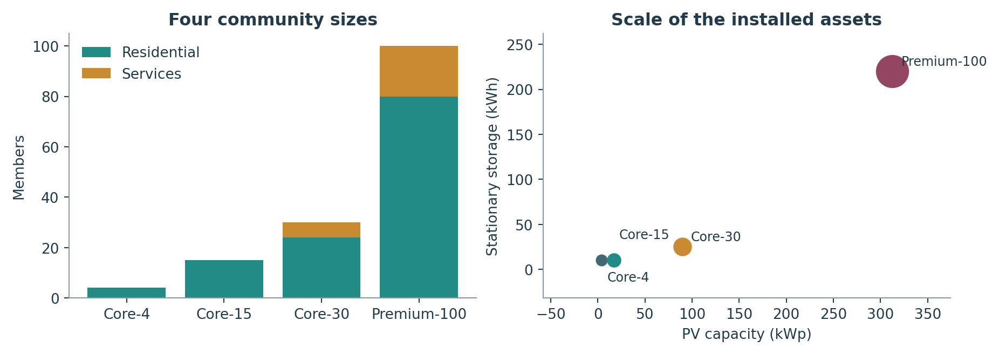
Figure 2. Residential/service composition and the scale of PV and stationary storage. Bubble area increases with connector count; exact totals are given in the table.

A charging site can have several connectors. An EV identity can visit more than one site. An appliance count refers to a physical device, whereas each device can issue many cycle requests over the two years. These quantities are therefore kept separate.

# From sources to community data
*03 / CONSTRUCTION AND TIME | PDF page 5*

The collection combines public external series with a synthetic inventory and operating schedules. The resulting records describe fictional members and equipment on a common chronological axis.

| Layer | Construction | Output in the dataset |
| --- | --- | --- |
| Members and buildings | Household routines, floor area, available roof area and service archetypes. | Member catalogue, narratives and operating calendars. |
| Electricity demand | E-REDES shape priors, occupancy/routine draws and simplified end-use components. | Non-shiftable load and a component ledger. |
| PV and weather | Lisbon solar resource, temperature and wind; array geometry, shading and inverter ratings. | Quarter-hour weather and per-site absolute PV generation. |
| Mobility and appliances | Declared vehicles and connectors; visits, SOC preferences and integrated cycle profiles. | Connection records, departure requests and start/deadline windows. |
| Market and carbon | OMIE wholesale prices; REN, REE and APA carbon reference information. | Common price and operational carbon-intensity series. |
| Scenario overlays | Schema-defined changes and event files with deterministic timing. | Topology, observation/action/asset events, outages and DR requests. |

## A continuous two-year calendar

Each base contains 35,040 records for 2023 and 35,136 for leap-year 2024: 70,176 consecutive quarter-hour records. The time index is regular in UTC. Residential and business timing is expressed in Europe/Lisbon, including daylight-saving changes, holidays and school breaks.

Local days at daylight-saving transitions contain 92 or 100 quarter-hours. The regular UTC index preserves elapsed time, while civil-time fields preserve the meaning of opening hours and household schedules. 2024 continues the community state reached at the end of 2023; membership is not reset.

Public observations, reanalysis and satellite products provide the external context. Individual household loads, visits, cycle requests and event campaigns are constructed scenarios, rather than recordings from the people named in the atlas.

# Households and premises
*04 / POPULATION AND BUILDINGS | PDF page 6*

The two smaller bases are residential. Core-30 combines 24 households with six services, and Premium combines 80 households with 20 services. The latter include four offices, four retail shops, three clinics, three cafes, three workshops, a sports centre, a grocery store and a care home.

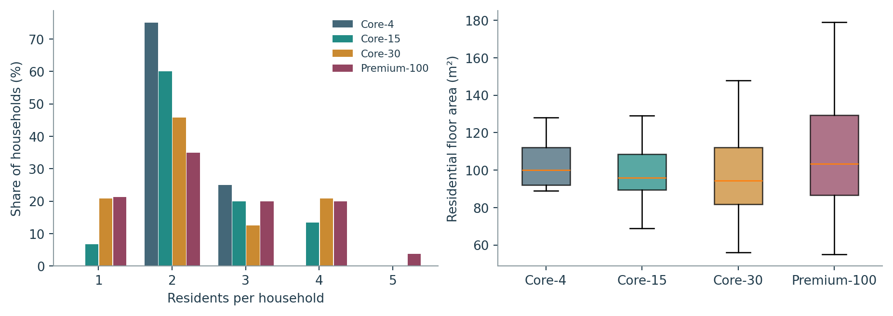
Figure 3. Household-size distributions and residential floor-area distributions. Boxes show the median and interquartile range; isolated boxplot outliers are hidden for readability.

| Base | Household residents | Home area: min / median / max (m²) |
| --- | --- | --- |
| Core-4 | 9 | 89 / 100.0 / 128 |
| Core-15 | 36 | 56 / 96.0 / 129 |
| Core-30 | 56 | 56 / 94.5 / 148 |
| Premium-100 | 200 | 55 / 103.5 / 179 |

Premium households contain one to five residents, with a median of two. Residential floor area spans 55-179 m². Service premises introduce a separate scale: the main office occupies 650 m², the sports centre 750 m², the grocery store 500 m² and the care home 900 m².

The catalogue occupant count describes household residents. A zero in that field for a service site does not describe an empty workplace; service operation is represented through its own activity profile and opening calendar.

# Daily life and opening calendars
*05 / ROUTINES | PDF page 7*

Residential routines include daytime commuters, hybrid workers, night-shift workers, school-run households, retired residents and people working late. This produces morning returns, intermediate visits and extended daytime presence as well as conventional evening arrivals.

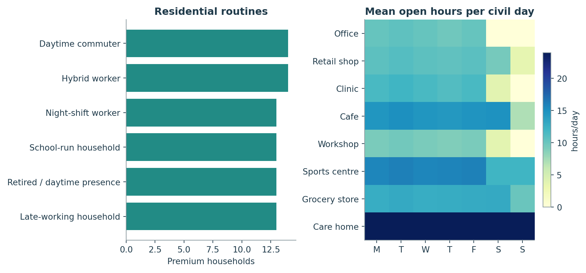
Figure 4. Premium residential archetypes and mean opening hours by weekday in 2024. The opening-hour summary includes holidays; it is an average over actual civil days.

Offices close at weekends and on the applicable holidays. Retail, hospitality and other services have their own calendars; weekend operation is therefore not treated as a universal exception. The care home has a continuous operating pattern.

## Examples from the member atlas

**Premium 003:** a four-person, 131 m² household associated with night-shift work and a home charging connector. **Premium 004:** a three-person, 122 m² school-run household with PV and a 5.12 kWh stationary battery. **Premium 081:** a 650 m² office with twelve connectors, PV, a 10.24 kWh battery and controllable appliance cycles.

Names and life stories are fictional descriptions of the same catalogue used to construct the data. They give a readable context to schedules and equipment; they are not personal survey records.

# Ownership and mixed participation
*06 / ASSET DISTRIBUTION | PDF page 8*

Asset ownership overlaps: a member can host PV, storage, charging and flexible cycles in several combinations. Members without any of these assets remain part of the community demand.

Figure 5. Premium ownership by member and asset-ownership shares across all four bases. The horizontal line after Premium member 080 separates households from services. Consumption-only means no PV, stationary battery, EV connector or controllable appliance.

| Base | Consumption only | PV owners | Battery owners | Charging sites |
| --- | --- | --- | --- | --- |
| Core-4 | 1 (25.0%) | 25.0% | 25.0% | 50.0% |
| Core-15 | 5 (33.3%) | 26.7% | 6.7% | 33.3% |
| Core-30 | 10 (33.3%) | 33.3% | 10.0% | 33.3% |
| Premium-100 | 32 (32.0%) | 36.0% | 20.0% | 41.0% |

Premium has 32 consumption-only members and stationary batteries at 20% of sites. Its richer equipment mix is concentrated in particular households and services; it does not require identical equipment at every site.

# Electricity demand and end uses
*07 / ANNUAL INPUT ENERGY | PDF page 9*

Non-shiftable demand is supplied directly as interval energy. It combines a base component with fixed appliance cycles and, where present, electric hot-water, heating, cooling and battery-standby components. Controllable appliance cycles are supplied as separate requests.

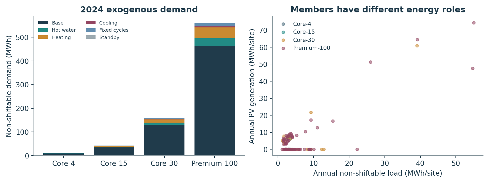
Figure 6. The 2024 non-shiftable demand ledger and each member's annual load/PV position in its static base. These annual totals do not estimate self-consumption or grid exports.

| Base | Load 2023 / 2024 (MWh) | PV 2023 / 2024 (MWh) | Flexible cycles 2024 (MWh) |
| --- | --- | --- | --- |
| Core-4 | 12.10 / 11.79 | 5.44 / 5.37 | 0.29 |
| Core-15 | 43.82 / 42.58 | 25.19 / 24.81 | 1.39 |
| Core-30 | 164.94 / 158.39 | 131.38 / 129.07 | 3.62 |
| Premium-100 | 583.81 / 560.19 | 476.60 / 469.16 | 11.78 |

The annual columns are sums of input energy. EV charging energy and stationary-battery operation are not added because they require control decisions. The cycle column is requested programme energy; fixed cycles are already inside non-shiftable demand and are not counted again.

Heating and cooling are simplified electricity components responsive to the weather. They describe demand variation without introducing a separate building-comfort model.

# Demand through the seasons
*08 / MONTHLY PROFILES | PDF page 10*

The two years retain the same physical inventory while using their own calendars and external series. Monthly demand reflects activity schedules, vacations and temperature-dependent end uses.

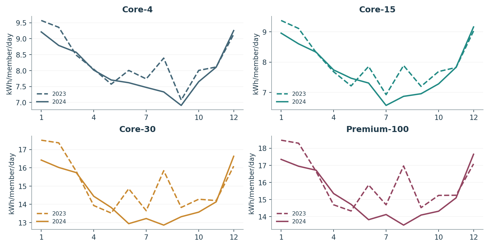
Figure 7. Monthly mean non-shiftable demand per catalogue member. Dashed lines are 2023; solid lines are 2024. Dividing by days in each month avoids treating a longer month as higher daily demand.

Core-4 and Core-15 show the residential shape. Core-30 and Premium include higher-consuming service premises, so their per-member mean is not a household-consumption statistic. The normalisation is useful for viewing changes within a base, rather than assuming that every member represents the same type of building.

The 2024 generation procedure retains equipment ratings and daily reference budgets, draws new operating schedules and adjusts heating/cooling components using the temperature record. Leap day, movable holidays, school breaks and civil-time changes are represented explicitly.

These curves describe the static bases. Event-conditioned input files additionally apply membership and asset availability in the dynamic configurations.

# Weekdays, weekends and holidays
*09 / INTRADAY DEMAND | PDF page 11*

Calendar effects are encoded in both the activity rules and the resulting load profiles. Separating residential and service members shows different changes in timing and daytime demand.

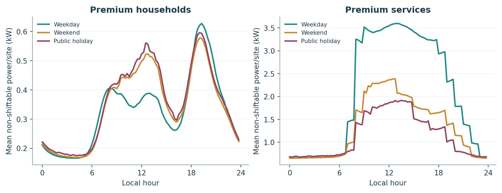
Figure 8. Premium mean non-shiftable power per site in 2024, separated by residential/services and mutually exclusive day classes. Public holidays take precedence over weekend classification.

Residential profiles retain morning and evening activity while the midday shape varies with the day class. Service demand rises with opening hours. Its weekend and holiday aggregates remain nonzero because the service group contains sites such as cafes, retail businesses and the care home.

## How the average is formed

The input interval energy is converted to average power by multiplying by four. Values are grouped by Lisbon civil hour and day class, then averaged across the relevant members. The chart shows the average over many days; it does not imply that every Tuesday or every household follows exactly the same curve.

The seasonal and intraday views complement one another: a monthly total describes energy volume, whereas the civil-hour profile describes when that energy is requested.

# The distribution of demand
*10 / MEMBER CONTRIBUTIONS | PDF page 12*

Larger service sites account for a different share of energy than individual homes. Ranked energy contributions make this composition visible without conflating a member count with an energy share.

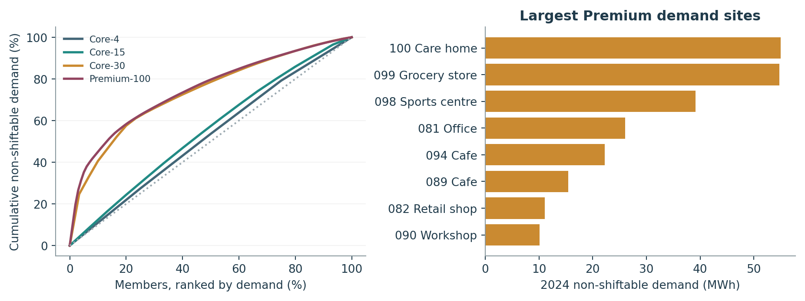
Figure 9. Cumulative 2024 non-shiftable demand, with members ranked from largest to smallest, and the eight largest Premium demand sites. The dotted line represents equal demand per member.

| Base | Largest member | Largest five members | Largest 20% of members |
| --- | --- | --- | --- |
| Core-4 | 27.4% | 100.0% | 27.4% |
| Core-15 | 8.3% | 39.5% | 24.3% |
| Core-30 | 24.7% | 52.3% | 57.5% |
| Premium-100 | 9.8% | 35.2% | 58.3% |

Core-30's largest site represents 24.7% of non-shiftable demand. Premium's largest site represents 9.8%, while its five largest sites jointly account for 35.2%. These are descriptive consequences of the catalogue's residential/service mix.

For Core-4, the largest-five column includes all four members. The largest-20% column uses the ceiling of 20% of the member count. All shares use the same static-base demand denominator.

# PV installations and physical ratings
*11 / SOLAR ASSETS | PDF page 13*

Arrays are built from integer numbers of 420 Wp modules, subject to available roof area and a separate AC inverter rating. Different tilts, azimuths and shading factors give the sites distinct production profiles under the common weather record.

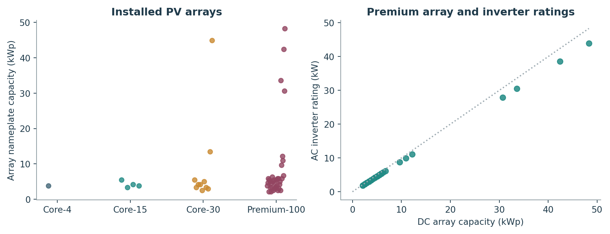
Figure 10. PV array nameplate capacity by base and Premium DC/AC ratings. Each point is an installation. The dotted line marks equal DC array and AC inverter ratings.

| Base | PV modules | PV sites | Smallest / largest array (kWp) | Total capacity (kWp) |
| --- | --- | --- | --- | --- |
| Core-4 | 9 | 1 | 3.78 / 3.78 | 3.78 |
| Core-15 | 40 | 4 | 3.36 / 5.46 | 16.80 |
| Core-30 | 213 | 10 | 2.52 / 44.94 | 89.46 |
| Premium-100 | 744 | 36 | 2.10 / 48.30 | 312.48 |

Premium arrays span 2.10-48.30 kWp. Its 36 PV sites comprise 744 modules with 312.48 kWp of total DC capacity. Orientations include east, southeast, south, southwest and west; the available tilt classes are 10, 20, 30 and 35 degrees.

The solar_generation field is absolute energy for a quarter-hour interval. It is not a normalised one-kilowatt production factor. Rated array power, inverter power and interval generation are separate quantities.

# Solar seasonality and daylight
*12 / PRODUCTION PATTERNS | PDF page 14*

Solar production follows the annual light cycle and the weather for each year. The same equipment persists into 2024, allowing differences in the resource and calendar to be visible without changing the array inventory.

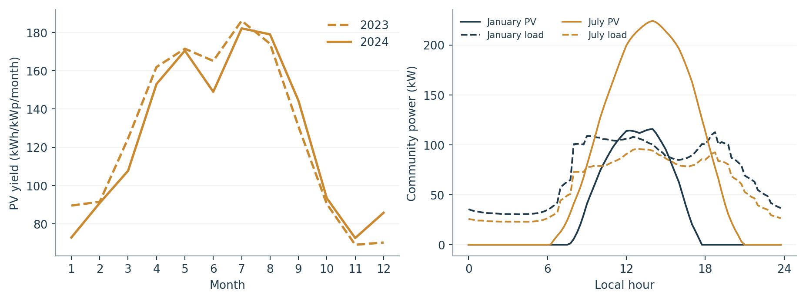
Figure 11. Premium monthly specific PV yield and mean January/July 2024 power profiles. Solid intraday curves show PV; dashed curves show non-shiftable load. They are descriptive averages, not a dispatch or sharing calculation.

| Base | 2023 yield (kWh/kWp) | 2024 yield (kWh/kWp) |
| --- | --- | --- |
| Core-4 | 1,438 | 1,421 |
| Core-15 | 1,499 | 1,477 |
| Core-30 | 1,469 | 1,443 |
| Premium-100 | 1,525 | 1,501 |

The longer summer production window is visible in the daily profiles and in the cover calendar. Different days within the same season still have different solar output; the yearly record is not a repeated clear-sky day.

The yield denominator is the full static-base DC capacity. An annual or monthly PV total alone does not determine how much production can be used by the community at the time it occurs.

# Stationary battery inventory
*13 / STORAGE ASSETS | PDF page 15*

Stationary batteries are discrete assets with energy capacity, power limits, efficiency, initial SOC and self-discharge parameters. Their inventory can be described independently of any charging or discharging policy.

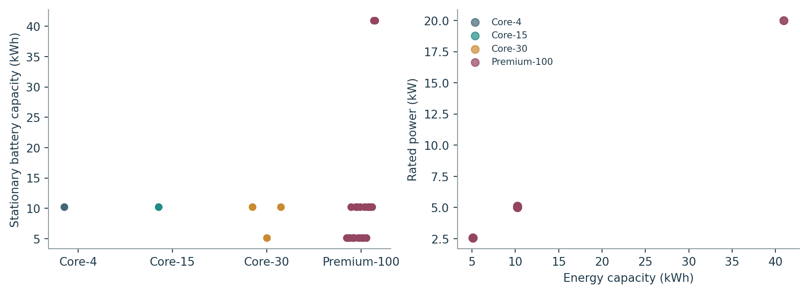
Figure 12. Stationary battery capacities and energy/power pairs. Repeated products may overlap in the scatter plot; the table gives the exact counts.

| Base | Batteries | Total energy (kWh) | Total rated power (kW) | Capacity classes (kWh: count) |
| --- | --- | --- | --- | --- |
| Core-4 | 1 | 10.24 | 5.00 | 10.24: 1 |
| Core-15 | 1 | 10.24 | 5.00 | 10.24: 1 |
| Core-30 | 3 | 25.60 | 12.68 | 5.12: 1; 10.24: 2 |
| Premium-100 | 20 | 220.16 | 108.40 | 5.12: 9; 10.24: 9; 40.96: 2 |

Premium includes nine 5.12 kWh batteries, nine 10.24 kWh batteries and two 40.96 kWh batteries. The total is 220.16 kWh and 108.40 kW. The two larger products are located at the sports centre and care home.

The catalogue uses a 90% depth-of-discharge setting and a 0.94 efficiency parameter, with explicit power curves and self-discharge. Physical battery cycle counts, annual throughput and lifetime use are outcomes of later operation and are not properties inferred in this report.

# Electrical connections and phases
*14 / SITE LIMITS | PDF page 16*

Every member has an electrical-service definition. It records the connection type, total import/export limits and the limits assigned to each phase. Equipment ratings and connection limits are therefore separate parts of the data.

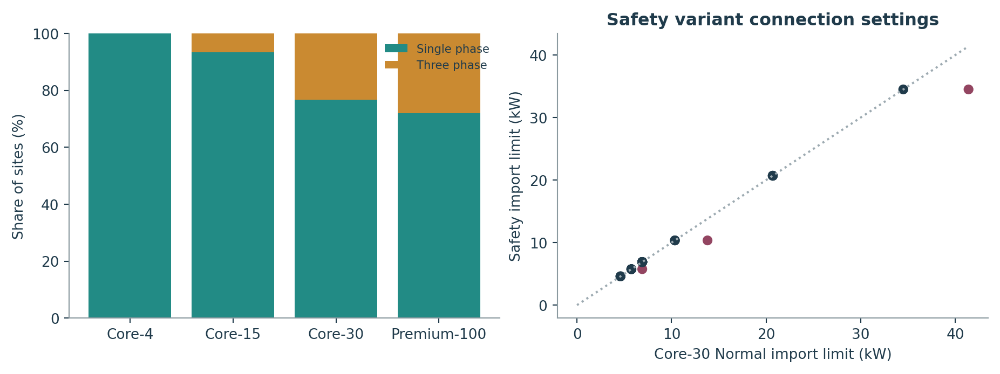
Figure 13. Single/three-phase site proportions and the selected Core-30 import-limit changes in Safety. Points below the dotted line have a reduced limit; overlapping points correspond to repeated connection levels.

| Base | Single phase | Three phase |
| --- | --- | --- |
| Core-4 | 4 | 0 |
| Core-15 | 14 | 1 |
| Core-30 | 23 | 7 |
| Premium-100 | 72 | 28 |

Single-phase sites assign the connection capacity to one phase and use zero capacity on the unused phases. Three-phase sites specify capacity across L1, L2 and L3. The supplied active-power convention uses a power factor of one; the connection catalogue records that assumption.

Core-30 Safety changes selected limits while retaining the base equipment and demand inputs. Combined uses the same electrical-stress layer alongside its lifecycle and health history. Normal configurations also have explicit physical limits; the Safety label identifies a changed scenario, not the first introduction of limits.

Per-phase quantities describe the declared connection and asset allocation. This is an aggregate active-power dataset, rather than a feeder voltage or protection-coordination study.

# Electric vehicles and battery sizes
*15 / THE VEHICLE CATALOGUE | PDF page 17*

Vehicles have persistent identities in the catalogue, with usable battery capacity, accepted AC power and SOC preferences. Resident vehicles are associated with a home member; additional vehicle pools represent visitors to service sites.

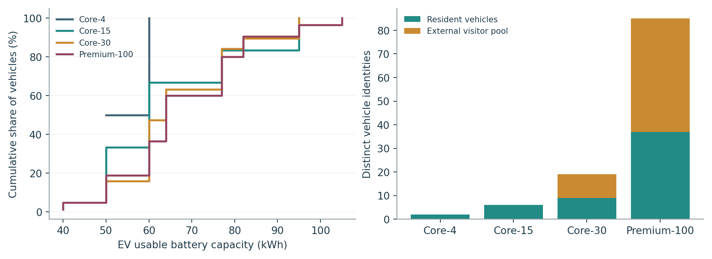
Figure 14. EV usable-capacity distributions and the split between resident vehicles and external visitors. Cumulative curves count vehicle identities, not charging sessions.

| Base | Residents / visitors | EV capacity range (kWh) | Home-work linked identities |
| --- | --- | --- | --- |
| Core-4 | 2 / 0 | 50-60 | 0 |
| Core-15 | 6 / 0 | 50-95 | 0 |
| Core-30 | 9 / 10 | 50-95 | 1 |
| Premium-100 | 37 / 48 | 40-105 | 4 |

Premium contains 85 vehicle identities: 37 resident vehicles and 48 visitors. Its battery classes extend from 40 to 105 kWh, including 77, 82 and 95 kWh products. Maximum accepted AC power is declared separately from battery energy capacity.

A vehicle with a large battery can be connected to a modest-power home charger. The vehicle limit and the connector rating both form part of the input specification; neither guarantees that a particular departure request will be delivered.

# Where charging infrastructure sits
*16 / CONNECTORS AND SITES | PDF page 18*

Charging is distributed between homes and services. Connector counts vary by site, including households with two connectors and a larger office charging location. The connector catalogue preserves individual identities and phase connections.

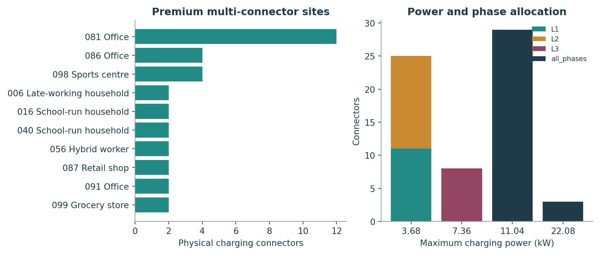
Figure 15. The ten Premium sites with the most connectors, and connector counts by rated charging power and phase assignment. all_phases denotes a three-phase connection.

Premium has 65 connectors across 41 sites. Office 081 has twelve; Office 086 and the sports centre each have four. Other sites include two-connector homes and smaller service charging locations.

| Premium connector rating (kW) | 3.68 | 7.36 | 11.04 | 22.08 |
| --- | --- | --- | --- | --- |
| Connector count | 25 | 8 | 29 | 3 |

The published connector catalogue sets maximum discharging power to zero. Vehicle-to-grid export is not part of these connector specifications. Charging availability is represented separately through vehicle connection records.

# Arrivals and departures
*17 / SESSION TIMING | PDF page 19*

The connection schedules contain morning, daytime and evening movements. Residential and service locations have different timing distributions, and the residential group includes routines that overlap with conventional office hours.

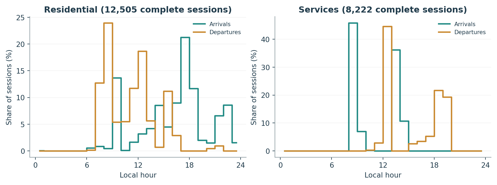
Figure 16. Premium 2024 arrival and departure hours for complete sessions in the Normal input files. Histograms use one-hour bins in Lisbon civil time. Sessions crossing the start or end of the two-year record are excluded here.

| Base | Sessions starting in 2023 | Sessions starting in 2024 |
| --- | --- | --- |
| Core-4 | 620 | 617 |
| Core-15 | 1,925 | 1,919 |
| Core-30 | 4,826 | 4,865 |
| Premium-100 | 20,524 | 20,764 |

Session counts refer to visits reconstructed from each Normal configuration's connector records. A visit spanning New Year remains one visit and is attributed to its start year. This preserves the distinction between a new arrival and a continuation of existing parking.

A connection interval gives the period during which charging may be available. It does not indicate that a vehicle charges continuously for the full interval.

# Requested SOC and connection duration
*18 / SERVICE REQUESTS | PDF page 20*

Departure targets vary by visit. They combine the user preference and preparation for forthcoming travel, producing a spread of requested SOC values rather than one universal target. All declared targets remain within the accepted 50-100% range.

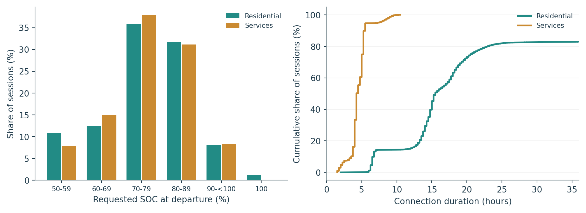
Figure 17. Premium 2024 target-SOC bands and cumulative connection-duration distributions for complete sessions. The final SOC band is exactly 100%. The duration axis displays the first 36 hours; residential parking has a longer tail.

| Base | Median target SOC | Sessions requesting 100% | Median / 90th-percentile dwell (h) |
| --- | --- | --- | --- |
| Core-4 | 83.7% | 2.84% | 14.75 / 40.75 |
| Core-15 | 78.3% | 1.28% | 15.00 / 43.25 |
| Core-30 | 78.5% | 0.95% | 13.25 / 29.75 |
| Premium-100 | 78.5% | 0.77% | 13.00 / 37.00 |

The table uses complete sessions across both years. A long parking interval can include time when no additional charging is needed. Likewise, a high requested SOC is a service request rather than an observation of energy delivered.

Arrival SOC is supplied in the input records. Requested energy gaps can be described from capacity and the difference between arrival and target SOC, but an annual charging-energy total requires the control trajectory.

# Connection availability across the week
*19 / WHEN FLEXIBILITY IS PRESENT | PDF page 21*

A weekly view complements the arrival and departure histograms. It shows how many connectors are occupied at the same time, averaged over the year, and how that pattern differs between homes and services.

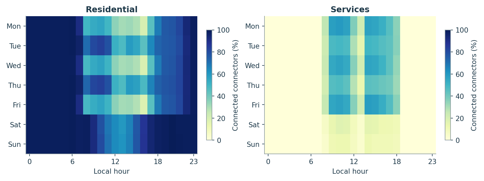
Figure 18. Mean fraction of Premium connectors with a vehicle connected, by local hour and weekday in 2024. Residential and service connectors use separate denominators. These are scheduled connections, not charging utilisation.

Residential connectors are more often occupied overnight, while service connectors concentrate their occupancy in operating hours. Some home connectors remain occupied during the day because the household routines include working from home, school-run returns, retirement and shift work.

Service availability reflects a mix of offices, retail and other sites. Weekend connection rates are therefore shaped by the composition and opening calendars, not by an assumption that all services behave like an office.

## Interpreting the colour scale

A value of 50% means that, in the selected hour/weekday group, half of the available connector records are in the connected state on average. It does not mean half of installed charging power is being used.

# Home-work links and recurring visitors
*20 / MOBILITY STRUCTURE | PDF page 22*

A subset of resident vehicles has a declared work destination inside the community. This links home and workplace availability for the same vehicle identity, alongside separate recurring visitor pools.

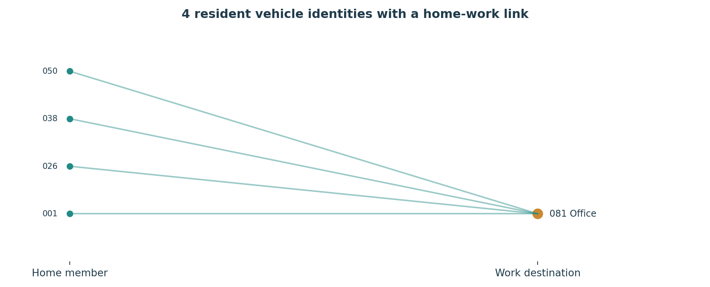
Figure 19. The four resident vehicle identities with a home-work link in Premium. Each edge joins a home member to the designated work member; repeated daily journeys are not drawn separately.

Premium links homes 001, 026, 038 and 050 to Office 081. Core-30 includes one home-work link. The smaller residential bases do not contain a workplace member.

External visitors also have vehicle identities and equipment attributes. They can appear repeatedly at a service site without becoming a resident member of the community. The distinction between visitors and members keeps the mobility population separate from the REC membership count.

The visit data support different lengths of service stop, including split working-day visits. Vehicle identity and the connection calendar describe where a car is available; arrival SOC is prescribed for each session in the original simulator contract. The report therefore does not treat the mobility catalogue as a measured longitudinal battery-energy balance.

# Appliance programmes and cycles
*21 / FLEXIBLE APPLIANCES | PDF page 23*

The appliance catalogue contains washing machines and dishwashers. Some follow fixed schedules already incorporated into non-shiftable demand; others expose their cycle-start decision through the controllable appliance interface.

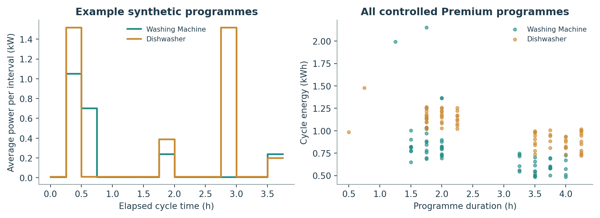
Figure 20. Illustrative Premium washing-machine and dishwasher programmes, and the energy/duration distribution of all controllable programme profiles. Powers are interval averages obtained from the stored quarter-hour cycle energy.

| Base | Controlled devices | Fixed devices | Requested cycles, 2023 / 2024 |
| --- | --- | --- | --- |
| Core-4 | 2 | 5 | 334 / 347 |
| Core-15 | 10 | 18 | 1,722 / 1,721 |
| Core-30 | 19 | 27 | 3,851 / 3,790 |
| Premium-100 | 64 | 84 | 12,820 / 12,701 |

Cycle profiles preserve the sequence of higher-power heating stages and lower-power motor or waiting stages at 15-minute resolution. Different programmes have different durations and energy requirements. These are integrated synthetic waveforms rather than recordings of individual appliance models.

The published appliance classes are washing machines and dishwashers; a separate tumble-dryer dependency chain is not part of this catalogue.

# Windows for starting a cycle
*22 / TIME FLEXIBILITY | PDF page 24*

Each controllable request identifies a programme, earliest start, latest start and completion deadline. This describes when the service may occur while retaining the programme's ordered energy profile.

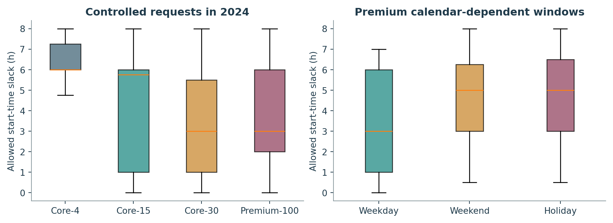
Figure 21. Allowed start-time slack in 2024: latest start minus earliest start. Left: distribution by base. Right: Premium weekday/weekend/holiday requests. Boxplots show medians, quartiles and non-outlier whiskers.

| Base | Median start slack (h) | 10th-90th percentile (h) | Median cycle duration (h) |
| --- | --- | --- | --- |
| Core-4 | 6.00 | 6.00-8.00 | 3.25 |
| Core-15 | 6.00 | 1.00-7.50 | 3.50 |
| Core-30 | 3.00 | 1.00-7.00 | 3.25 |
| Premium-100 | 3.00 | 1.00-7.00 | 3.50 |

The table summarises both years; the chart isolates 2024. The range includes narrow or fixed-start requests as well as windows extending up to eight hours. Calendar-dependent windows and different household preferences provide variation between requests.

Start slack is not interchangeable with cycle duration or deadline slack. A long cycle can have a narrow start window, and a broad start window does not change the energy required by its selected programme.

# A community that changes over time
*23 / MEMBERSHIP AND ASSET HISTORIES | PDF page 25*

Dynamic configurations represent first admissions, permanent departures, equipment commissioning, replacement and retirement. These events change the inventory present in the scenario, rather than repeatedly switching the same departed member in and out.

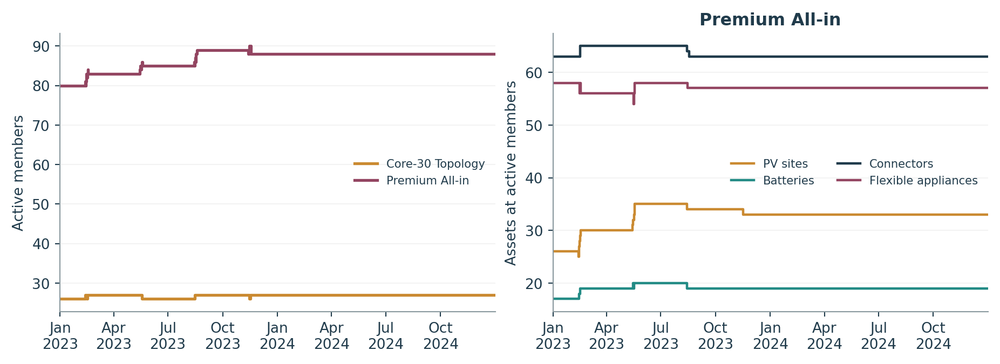
Figure 22. Active member trajectories and the Premium All-in asset inventory. Asset counts include only active members. The unchanged 2024 segment carries forward the state reached in 2023.

| Configuration | Members | PV sites | Batteries | Connectors | Flexible devices |
| --- | --- | --- | --- | --- | --- |
| Core-30 Topology | 26 to 27 | 8 to 9 | 2 to 2 | 14 to 13 | 17 to 18 |
| Premium All-in | 80 to 88 | 26 to 33 | 17 to 19 | 63 to 63 | 58 to 57 |

Core-30 Topology has four admissions and three departures, moving from 26 to 27 active members. Combined shares this history. Premium All-in has twenty admissions and twelve departures, moving from 80 to 88.

The topology events occur in 2023. They are not replayed in 2024, and departed members do not re-enter. Health, outage, noise and DR campaigns have their own two-year schedules, separate from this permanent membership history.

# Events behind the member stories
*24 / LIFECYCLE EXAMPLES | PDF page 26*

The atlas and the lifecycle catalogues are generated from the executable schema events. A member's description therefore distinguishes the static configuration from a variant in which its participation or equipment changes.

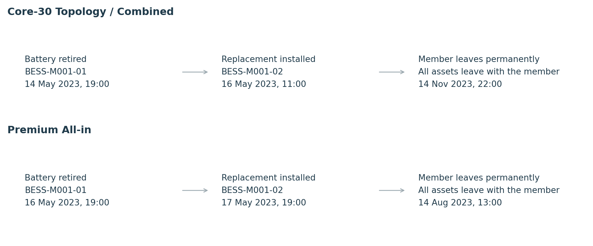
Figure 23. Two histories for member 001, with Lisbon civil timestamps. The matching member label belongs to a different base in each row; the dates are not assumed to be identical.

In Core-30 Topology and Combined, the first stationary battery is removed on 14 May and its replacement is installed on 16 May. Member 001 leaves on 14 November at 22:00. In Premium All-in, the battery replacement occurs on 16-17 May and the member leaves on 14 August at 13:00.

A replacement is a new physical asset identity. A permanent departure removes the member and its associated activity from the scenario. Retired appliances no longer generate future service requests; outstanding or interrupted cycles are cancelled according to the supplied lifecycle treatment.

Static variants retain their catalogue membership. The same member's narrative therefore names the configuration in which each transition applies, instead of presenting one date as universal across the family.

The event catalogue excludes internal template-registration operations from the real-world narrative. Templates used to introduce a later asset are not described as physical retirements.

# Health events and measurement noise
*25 / INFORMATION AND EQUIPMENT EVENTS | PDF page 27*

Health events and measurement noise are stored as separate input layers. Health includes missing observations, biased price forecasts, delayed or dropped commands and unavailable assets. Measurement noise perturbs selected observation channels using the configured distribution and seed.

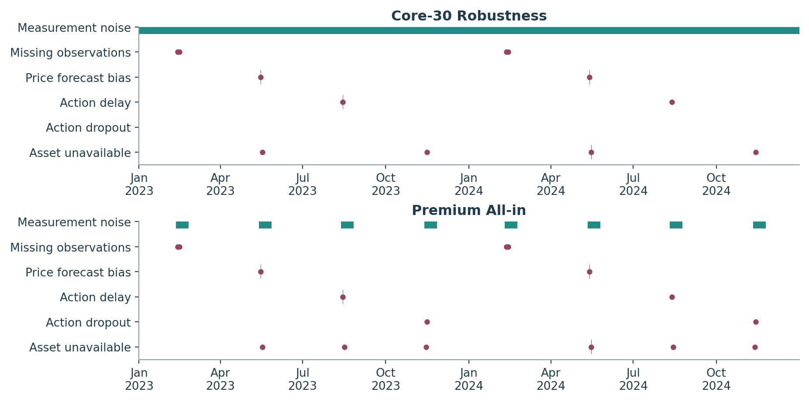
Figure 24. Development schedules across both years. Thin events are marked with points for visibility; marker width is not event duration. Core-30 Robustness has continuous measurement noise; Premium All-in has seasonal campaigns.

The measurement settings are 0.005 kWh per interval for non-shiftable load, 0.020 kW for PV power and 0.005 SOC fraction for selected EV/battery channels. These correspond to 20 W and 0.5 percentage points for the respective channels. Domain clipping keeps the declared observation values within the specified ranges.

Premium uses four 14-day development campaigns per year: 56 days per year and 112 days across the collection. Core-30 Combined includes health events without the continuous measurement-noise layer.

A logical event can appear on several channels. Event-row counts are consequently different from distinct campaign counts or elapsed exposure. Reserved confirmation files provide a separate event schedule.

# Scheduled grid interruptions
*26 / OUTAGE INPUTS | PDF page 28*

Grid availability is supplied as an interval-level input at the affected sites. Outage episodes cover different calendar periods and local times, and are distinct from an equipment-availability fault.

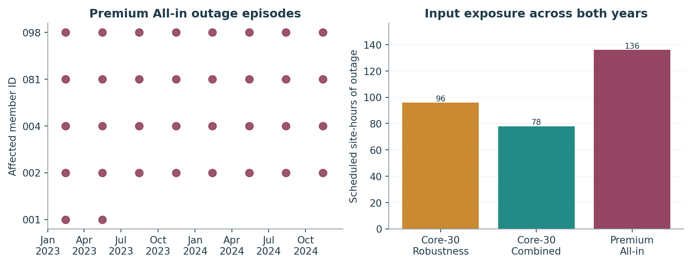
Figure 25. Premium All-in outage timing and cumulative scheduled site-hours in the three configurations containing outages. A site-hour counts one affected site for one hour; simultaneous sites are counted separately.

| Configuration | Distinct affected sites | Site-level episodes | Scheduled site-hours |
| --- | --- | --- | --- |
| Core-30 Robustness | 3 | 48 | 96 |
| Core-30 Combined | 3 | 40 | 80 |
| Premium All-in | 5 | 72 | 144 |

The global union of outage times is 32 hours across the two years in each of these configurations. The site-hour totals differ because several members can be affected simultaneously and membership changes can end a site's subsequent participation.

Stationary batteries are included in the backup convention used by the supplied scenarios. Backup availability is part of the scenario definition; the amount of demand actually served during an interruption depends on the battery state and subsequent operation. No served-energy or recovery result is inferred here.

# Explicit demand-response requests
*27 / PREMIUM ALL-IN | PDF page 29*

Demand response is represented by explicit requests, independently of the electricity-price sign. Each request provides a direction, active interval, target power and commercial parameters. DR is selected only in Premium All-in.

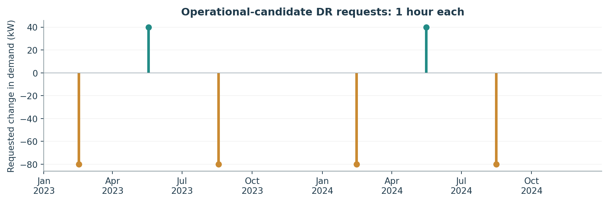
Figure 26. The operational-candidate requests in 2023 and 2024. Positive values request increased demand; negative values request a reduction. The separate 1,500 kW stress request is omitted from this axis to preserve the operational scale.

| Pattern in each year | Direction | Target (kW) | Duration (h) | Declared stratum |
| --- | --- | --- | --- | --- |
| dr_1 | down | 80 | 1.0 | service candidate |
| dr_2 | up | 40 | 1.0 | service candidate |
| dr_3 | down | 80 | 1.0 | service candidate |
| dr_4 | down | 1,500 | 4.0 | impossible stress |

Each year includes two one-hour reduction requests at 80 kW and one one-hour increase request at 40 kW. A separate four-hour reduction request at 1,500 kW is explicitly labelled impossible_stress. This label is retained as part of the request design rather than pooled with the operational candidates.

The files contain an activation price of EUR 0.12/kWh, a shortfall penalty of EUR 0.06/kWh and a 5% power tolerance. These are request parameters. The chart and table describe the requested service; they contain no estimate of delivered response, baseline quality, settlement or rebound.

# Electricity prices and carbon intensity
*28 / SHARED EXTERNAL SIGNALS | PDF page 30*

All members use the same variable grid-purchase price series. It is the Portuguese OMIE price in EUR/MWh divided by 1,000 and floored at zero, without retail additions. Carbon intensity is a separate time-aligned operational estimate based on the national production mix and an imports proxy.

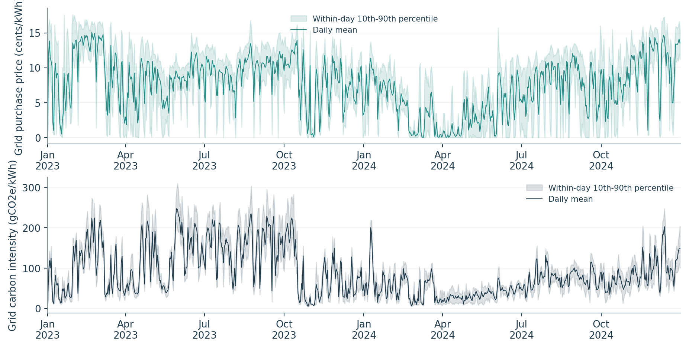
Figure 27. Daily mean price and carbon intensity over both years. Shading gives the within-day 10th-90th percentile. Price units are cents/kWh; carbon units are gCO2e/kWh.

| Year | Mean price (EUR/kWh) | Price range (EUR/kWh) | Mean carbon (gCO2e/kWh) |
| --- | --- | --- | --- |
| 2023 | 0.0871 | 0.0000 to 0.2200 | 112.3 |
| 2024 | 0.0631 | 0.0000 to 0.1930 | 62.8 |

Negative OMIE values become zero. No supplier margin, loss uplift, MIBEL, network tariff or tax is added. Every dataset schema enables community trading: buyers pay and sellers receive 80% of the grid-purchase price. Grid-export remuneration is zero.

Carbon is a derived average operational intensity, not a marginal-emissions or lifecycle accounting series. The component files retain the production/import calculation and its provenance.

# Weather variation and forecast inputs
*29 / THE EXTERNAL CONTEXT | PDF page 31*

Both years contain their own weather and market series. Solar, temperature and calendar changes act on the same equipment inventory. Forecast columns expose simple causal point estimates alongside the realised inputs.

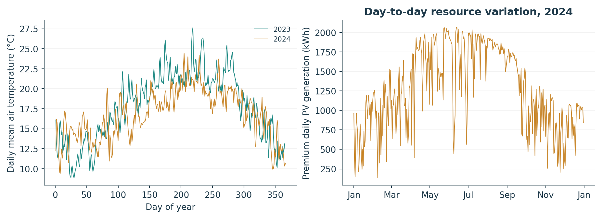
Figure 28. Daily mean air temperature in both years and Premium daily PV energy in 2024. The PV record contains day-to-day fluctuations within the seasonal envelope.

| 2024 forecast input | 1 h MAE | 6 h MAE | 24 h MAE | Unit |
| --- | --- | --- | --- | --- |
| Air temperature | 1.25 | 1.25 | 1.25 | °C |
| Relative humidity | 7.32 | 7.32 | 7.31 | percentage points |
| Direct irradiance, daytime | 186.21 | 186.21 | 185.59 | W/m² |
| Grid purchase price | 0.00 | 0.00 | 1.09 | cents/kWh |

Weather forecasts use daily persistence with an astronomical night mask for solar channels. Published day-ahead OMIE is used when available, with prior-day persistence otherwise. Daily persistence gives almost the same error for a common destination across horizons; it is a reference forecast method rather than a forecast ensemble.

The forecast table compares stored inputs with realised future samples, excluding the first and last day. Solar error uses daytime targets. One external support day completes final price-forecast destinations without adding a third simulated year. Humidity is a temperature-derived proxy in 2023 and ERA5 in 2024; that source difference is retained in the documentation.

# Files, units and reproducibility
*30 / USING THE DATA DESCRIPTION | PDF page 32*

The report is accompanied by computed tables and reusable figures. Their input identity is tied to the published dataset checksums, so the description can be regenerated when the catalogue changes.

| Location inside each dataset | Content |
| --- | --- |
| schema.json; evaluation/*.json | Default configuration and the current executable variants. |
| catalogs/ | Members, equipment, electrical services, annual totals and the derived lifecycle plan. |
| timeseries/; end_uses/ | Per-member physical series and the non-shiftable component ledger. |
| shared/ | Calendar, weather, price and carbon input series. |
| chargers/; deferrables/; mobility/ | Connection and cycle files, with supporting mobility records. |
| evaluation/native_inputs/ | Files actually selected by each original-engine configuration. |
| evaluation/events/ | Development and reserved confirmation event files. |
| MEMBER_STORIES.md; sources/ | Generated member narratives and clearly identified historical source material. |

## Units and denominators

Physical load, PV and cycle profiles use kWh per 15-minute interval; average kW equals interval kWh multiplied by four. Asset capacities use kWh, equipment power uses kW, PV nameplate uses kWp, SOC is a fraction in the files, prices use EUR/kWh and carbon uses kgCO2e/kWh.

Counts in this report are recomputed from current records. Historical annual_* catalogue fields are not substituted for two-year totals. Session and cycle distributions use the files selected by Normal schemas; dynamic event counts use their own schemas.

Supporting outputs: dataset_description/statistics.json, CSV tables and figures/descriptive/ in this documentation folder. The collection retains 2,828 static two-year input checks and 213 forecast/story checks. Those checks describe construction integrity; the present report contains no controller-performance measurements.

# Sources and construction references
*31 / PROVENANCE | PDF page 33*

The source archives and construction scripts accompany the published collection. The links below identify the principal providers and documents; the local source manifests retain the exact downloaded files, request parameters and hashes.

**[S1] Dataset release.** portugal-native-2023-2024-v3.2. Four physical bases and nine schemas. Manifest: results/portugal_rec_native/manifest.json. The original simulator revision is pinned in the manifest; only dataset construction and descriptive tools are used here.

**[S2] E-REDES load-shape priors.** [Consumption profiles 2023](https://www.e-redes.pt/sites/eredes/files/2023-01/E-REDES_Perfil_Consumo_2023.xlsx) and [consumption profiles 2024](https://www.e-redes.pt/sites/eredes/files/2023-12/E-REDES_Perfil_Consumo_2024.xlsx). Published chronological intervals, aligned to the common UTC axis.

**[S3] Solar resource and weather.** [European Commission PVGIS](https://joint-research-centre.ec.europa.eu/photovoltaic-geographical-information-system-pvgis_en), SARAH-3 and the archived PVGIS 5/6 queries for Lisbon, 38.72° N, 9.14° W. [Open-Meteo historical ERA5 interface](https://open-meteo.com/en/docs/historical-weather-api) for 2024 temperature, humidity, wind and documented solar gap fills. Hourly inputs are interpolated to 15 minutes.

**[S4] Wholesale prices.** [OMIE day-ahead market](https://www.omie.es/pt/market-results/daily/daily-market/day-ahead-price), Portuguese price zone. Market periods are interpreted in Europe/Madrid before UTC alignment. The active price uses OMIE only; archived MIBEL adjustments are historical provenance.

**[S5] Historical tariff references.** [ERSE electricity tariffs](https://www.erse.pt/atividade/regulacao/tarifas-e-precos-eletricidade), 2023 and 2024 schedules and their within-year revisions. Coopérnico and ERSE components belong to the archived retail edition and are excluded from current prices; [the 2024 TSE explanation](https://www.coopernico.org/artigo/366) documents that year's charge. Current forecast destinations use only published OMIE or causal daily persistence, with a zero floor.

**[S6] Electricity carbon estimate.** [REN Data Hub](https://datahub.ren.pt/en/api-instructions) production and exchange series; [REE API](https://www.ree.es/en/datos/apidata) for the Spanish imports proxy; [APA electricity-emission reference](https://apambiente.pt/clima/fator-de-emissao-de-gases-de-efeito-de-estufa-para-eletricidade-produzida-em-portugal) for calibration. The fixed 2023 thermal coefficient is retained for the 2024 derived estimate.

**[S7] Civil and school calendars.** Portuguese national and Lisbon municipal holidays; the applicable school calendars, including Despachos 8356/2022 and 8368/2024. The synthetic school schedule chooses a declared start date within the permitted interval.

**Companion documentation.** Fontes_e_metodo.md, Extensao_2024.md, Tarifas_e_mercado.md, Reproduzir.md, Previsoes_e_historias.md and Atlas_Membros_Premium.md provide the detailed construction record. Figures and statistical summaries in this report are computed from the current dataset edition, not reused from previous experiment reports.
