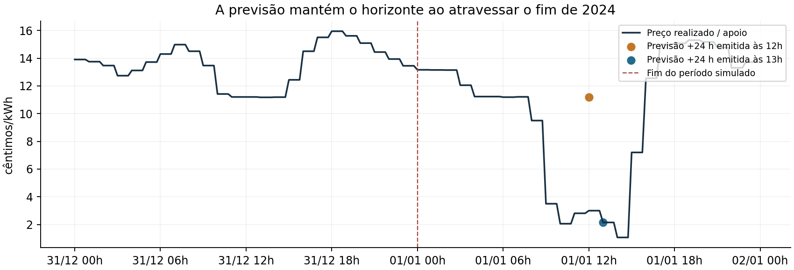
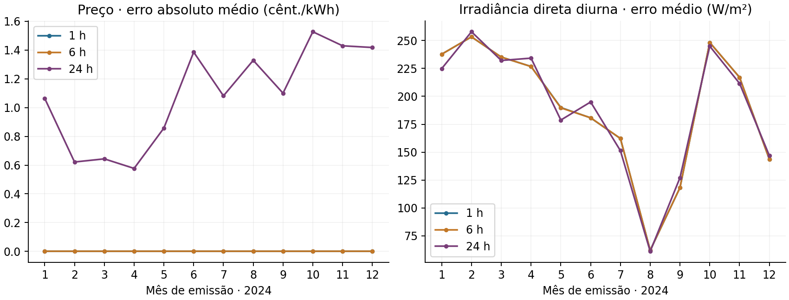

# Histórias, fronteira de 2024 e variabilidade das previsões

## Correções concluídas nos dados

O atlas, os ficheiros MEMBER_STORIES e os campos narrativos dos quatro catálogos passaram a usar os eventos dos schemas. O catálogo lifecycle_plan.json é agora derivado por configuração, com estado inicial e datas calculadas a partir do índice temporal. O desenho antigo fica apenas em sources/2023_original_lifecycle_plan.json. O registo interno de um carregador-modelo não é apresentado como remoção física. As transições de 2023 mantêm o seu efeito em 2024.

No Core-30 Topology/Combined, Member_001 sai em **14/11/2023 às 22h de Lisboa**. No Premium All-in sai em **14/08/2023 às 13h de Lisboa**. As variantes estáticas não recebem essas saídas. As datas incluem igualmente instalação, substituição e retirada de ativos. Não se alteraram eventos, inventário, perfis físicos ou pedidos EV.

Acrescentaram-se **96 amostras de apoio de 01/01/2025**, exclusivamente para os destinos das previsões de preço. As séries simuladas continuam com **70 176 registos**, terminando em 31/12/2024. Foram corrigidas as últimas 4, 24 e 96 posições das previsões de 1, 6 e 24 horas: 124 células por base. As horas de destino avançam para janeiro, em vez de ficarem presas a 31 de dezembro às 23h45. A meteorologia já tinha horizontes completos por persistência e não foi alterada.

O OMIE só é usado após a hora conservadora de publicação: 14h de Madrid, 13h de Lisboa. Antes disso usa-se o mesmo instante do dia anterior. Na edição v3.2, preços realizados e previstos são apenas OMIE/1000 com piso zero. Os destinos de janeiro seguem a mesma regra, sem componentes de retalho.

Fontes históricas de retalho, sem efeito nos preços da v3.2, arquivadas em data/portugal_reference_2024/forecast_support: [ERSE — tarifas 2025, p. 131](https://www.erse.pt/media/xczdo4as/tep-se-2025.pdf), [anúncio de 16/12/2024](https://www.erse.pt/media/jbyluyci/comunicado_tarifas-ee-2025.pdf), [TSE, anúncio de 20/12/2024](https://www.erse.pt/comunicacao/destaques/erse-aprova-diretivas-de-reparticao-do-financiamento-dos-custos-com-a-tarifa-social-de-eletricidade-de-2025/). O ficheiro OMIE de 2 de janeiro só é necessário porque a primeira hora de Madrid corresponde às 23h UTC do dia 1.

## O que significa «variabilidade» nesta edição

Há variação real das séries e erros de previsão resultantes de diferenças entre dias. Não existem previsões meteorológicas operacionais arquivadas, distribuições probabilísticas, intervalos de confiança ou níveis de qualidade sorteados por membro. Consumo e PV derivados no motor e meteorologia nos ficheiros seguem persistência diária; os preços combinam informação de mercado publicada com persistência quando ainda não foi publicada. Não se acrescentou ruído artificial às previsões nesta revisão.

Na persistência diária, a estimativa do mesmo destino é a observação desse instante 24 horas antes, independentemente de a emissão ocorrer a 1, 6 ou 24 horas. Por isso os erros médios por horizonte são quase iguais. As pequenas diferenças decorrem das amostras de destino e da máscara diurna. **A dificuldade de previsão não cresce de forma realista com o horizonte.** Trata-se de uma referência causal simples, não de um modelo meteorológico com atualização contínua.

O preço e a meteorologia são comuns a todas as famílias, coerentemente com a região e tarifa comuns. A heterogeneidade de carga e PV vem dos perfis e equipamentos; não existe heterogeneidade de qualidade de previsão por membro. A resolução de 15 minutos da meteorologia resulta de interpolação horária, pelo que não representa toda a variabilidade sub-horária de nuvens ou sensores.

Há uma diferença de origem na humidade: em 2023 é a aproximação sintética clip(78 − 1,7 × (temperatura − 14), 30, 95); em 2024 é ERA5. A subida do seu erro entre anos não pode ser interpretada apenas como mudança meteorológica. Preservou-se a edição física de 2023, como acordado. Para estudar especificamente previsão de humidade, essa diferença metodológica teria de ser tratada; não foi escondida nem corrigida com ruído arbitrário.

## Erros medidos nos ficheiros

MAE é o erro absoluto médio contra a amostra futura efetiva. Emissões após o primeiro dia e antes do último dia; mesma amostra de emissão para todos os horizontes; ano da emissão. Nos canais solares só se incluem destinos com irradiância total observada superior a 1 W/m². Não se contam as noites como acertos fáceis. Não são resultados de um controlador nem uma avaliação dos overlays de health.

| Sinal | Ano | MAE a 1 h | MAE a 6 h | MAE a 24 h | Unidade |
|---|---:|---:|---:|---:|---|
| Temperatura | 2023 | 1.160 | 1.159 | 1.156 | °C |
| Temperatura | 2024 | 1.252 | 1.251 | 1.250 | °C |
| Humidade | 2023 | 1.973 | 1.972 | 1.973 | p.p. |
| Humidade | 2024 | 7.319 | 7.317 | 7.312 | p.p. |
| Irradiância direta — diurna | 2023 | 179.512 | 179.512 | 179.440 | W/m² |
| Irradiância direta — diurna | 2024 | 186.206 | 186.206 | 185.590 | W/m² |
| Irradiância difusa — diurna | 2023 | 37.551 | 37.551 | 37.595 | W/m² |
| Irradiância difusa — diurna | 2024 | 38.899 | 38.899 | 38.880 | W/m² |
| Preço | 2023 | 0.000 | 0.000 | 1.182 | cêntimos/kWh |
| Preço | 2024 | 0.000 | 0.000 | 1.088 | cêntimos/kWh |

Os preços a 1 e 6 horas beneficiam de o OMIE já estar publicado. A 24 horas há períodos sem informação publicada, com maior erro. A edição v3.2 não usa MIBEL nem TSE: quando o OMIE de destino está publicado, a previsão coincide com a série realizada; o erro de persistência ocorre nos destinos ainda não publicados. O ficheiro JSON inclui erro quadrático, viés, percentil 95, desvio-padrão, fração publicada e erro do período sem publicação.

## Consumo e PV: referência física sem executar controladores

Erro absoluto da persistência diária, dividido pela média da série, nos agregados das quatro bases estáticas. O PV é contado apenas quando existe produção. A carga inclui o consumo não deslocável dos ficheiros; exclui carregamento EV, baterias e decisões sobre máquinas controladas. Não é uma medição das observações derivadas do motor, que também podem conter histórico de máquinas e efeitos da topologia. Todos os horizontes desta regra recorrem ao mesmo valor anterior para um dado destino.

| Base | Carga 2023 | Carga 2024 | PV diurno 2023 | PV diurno 2024 |
|---|---:|---:|---:|---:|
| core_15 | 14.9% | 14.2% | 20.2% | 22.3% |
| core_30 | 16.3% | 15.8% | 19.9% | 22.3% |
| micro_4 | 21.1% | 20.4% | 21.5% | 23.3% |
| premium_100 | 14.4% | 13.4% | 20.8% | 23.0% |

## Falhas e ruído continuam separados

Core-30 Robustness, Core-30 Combined e Premium All-in incluem um viés de preço de +0,025 €/kWh durante uma campanha de seis horas em cada ano, replicado nos canais relevantes. Por configuração, as 22 linhas de desenvolvimento representam canais e anos, não 22 acontecimentos independentes: são **12 horas distintas em 731 dias**, cerca de 0,068% do período. A confirmação reservada usa −0,035 €/kWh, oito horas em cada ano (16 horas no total). Isto testa falhas pontuais; não representa erro de previsão persistente durante todo o ano.

O ruído de medição continua separado, nas variantes configuradas: erros gaussianos nos canais escolhidos de potência e SOC, em campanhas sazonais. Não se transforma automaticamente num modelo de incerteza de previsão. Os ficheiros de verdade física foram preservados. Esta revisão inspeciona a configuração dos eventos, não certifica a sua execução no motor.

## Limite que não pode ser corrigido só nos datasets

O motor original limita internamente o índice de destino das previsões **derivadas de consumo e PV** ao último registo carregado, antes de procurar o dia anterior. O carregador de dados corta os ficheiros à janela de simulação; acrescentar linhas físicas de apoio não resolve esse caminho. Consequentemente, dentro das últimas 24 horas de um episódio continuam a existir canais derivados com horizonte encurtado. O mesmo problema pode ocorrer no fim de episódios mais curtos. Os preços armazenados, incluindo os usados pelo caminho nativo publication_aware, e a meteorologia têm os seus destinos completos.

Não foi alterado o simulador, nem desligados canais para esconder o problema. **O fecho desta revisão aplica-se às histórias e às previsões fornecidas pelos dados; não certifica a fronteira das previsões de consumo/PV calculadas pelo motor.** Resolver esse comportamento em execução exigiria uma decisão posterior sobre o motor ou sobre a interface do controlador. Não foi feita tal alteração.

Para uma futura investigação centrada na qualidade das previsões, falta um modelo validado com atualização por horizonte, correlações temporais e entre membros, além de qualidade diferenciada por sinal. Para os dados atuais fica documentada e quantificada a referência simples realmente existente.

Verificação desta revisão: 184 verificações, 0 falhas. Evidência: results/portugal_rec_native/forecasts_and_stories.json.
